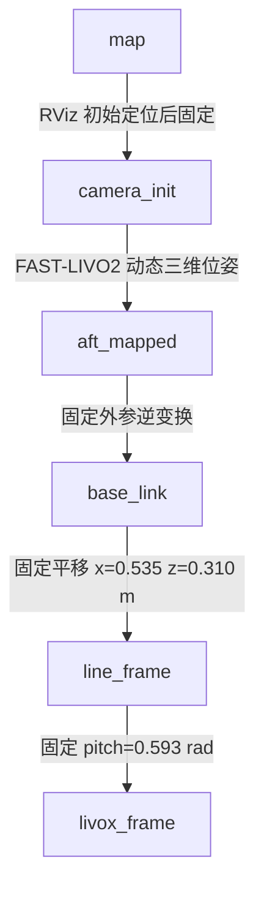
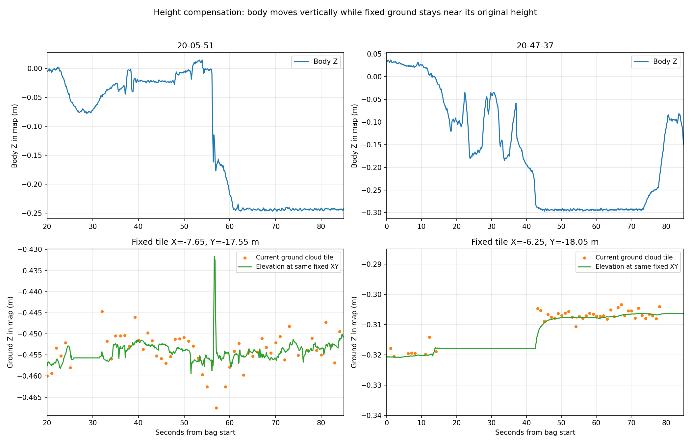
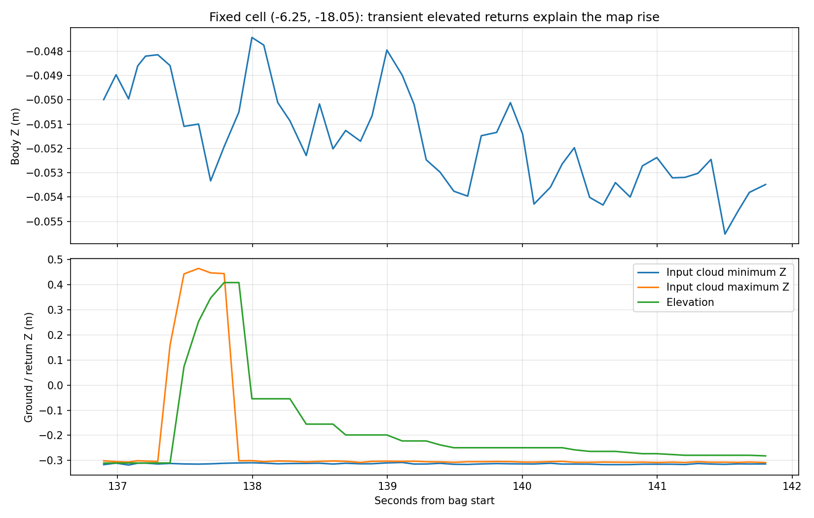

# 狗本体高度变化下的点云与高程图稳定性

本报告回答：本体坐下、站起时，点云和高程图能否保持静止地面的世界高度；坐着开机与站着开机为什么可能不同。

依据：当前启动链、FAST-LIVO2/高程源码，以及 2026-10-19 的 `19-41-37`、`20-05-51`、`20-47-37` 三份 bag。未获得三份 bag 的实际开机姿态标签，因此按包内高度变化分析，不把推测的坐姿/站姿冒充现场标注。未修改运行源码或参数。

## 直接判断

**本体高度补偿这条链路在起作用。现有数据没有显示机身降低二十多厘米，整片地面就跟着升高二十多厘米的失效。** 雷达注册点云的固定地面总体保持在厘米级变化；高程图的地面主体也保持在原高度附近。

但还不能将整个感知系统判定为“坐着、站着任意初始化都等价，所有栅格都稳定”：

- 当前地图的零高程和水平基准依赖点击 RViz 初始化时的机身位置/姿态，不是独立的地面/重力基准。
- 部分高程格出现明显变化，既有真实新增高点，也有融合/清理过程的历史效应，不能全部按本体升降漂移解释。
- TF 中把 `aft_mapped` 当作雷达原点，而估计器源码实际输出 IMU 位姿；当前外参非零，存在需要核对的约 5.55 cm 原点差。

## 1. 当前 TF 链及各段作用

三份 bag 中的链与启动脚本一致：



`camera_init → aft_mapped` 包含三维平移和旋转。本体升降主要通过这段表达，然后传递到 `base_link`。没有把 Z 固定或把动态姿态强制压成平面。

`base_link → line_frame → livox_frame` 表达雷达相对机身的刚性安装。这里的 **0.31 m 是相对机身的固定安装距离，不能当作雷达到地面的实时高度**。腿伸缩时，只要雷达仍固定在本体上，这段保持固定是合理的；雷达离地高度由前面的动态三维位姿体现。

`map → camera_init` 是初始化后固定的世界坐标变换，不需要随着每次站起/坐下重新计算。若运行中重新点击初始定位，则会改变地图坐标基准，不能把这种重新定位造成的跳变算作传感器高度补偿失效。本次三个包内该段均保持固定。

## 2. 点云和高程图怎样补偿高度

FAST-LIVO2 先计算：

```text
p_camera_init = R_imu × (R_lidar_to_imu × p_lidar + t_lidar_to_imu) + t_imu
p_map = T_map_camera_init × p_camera_init
```

机身升起时，原始雷达坐标中的地面点会相对向下；正确的动态位姿应把它们变回固定世界位置。因此应该检查固定世界地面，不应拿雷达系下地面点的 Z 是否变化作为稳定性标准。

高程图也有 Z 补偿：`move_to()` 将内部地图中心 Z 随机器人移动，同时 `shift_map_z(-Δz)` 扣掉对应内部高程；发布 `elevation` 时再加回中心 Z。其关系是：

```text
发布高程 = 内部相对高程 + 内部中心 Z
本体中心上移 Δz：内部高程减 Δz，中心 Z 加 Δz → 原地面发布高程不变
```

GridMap 的 pose.z 设为 0 不代表升降信息丢失，因为绝对高程已经放入 elevation 数值中。该补偿结构本身适用于腿式机器人的本体高度变化。

源码：

- `/home/nvidia/wsnew/ws_livox/src/FAST-LIVO2-master/src/LIVMapper.cpp:715`，点到世界的变换；`:1352`，动态 TF 发布。
- `/home/nvidia/elevation_map/src/elevation_mapping_cupy/elevation_mapping_cupy/elevation_mapping_cupy/elevation_mapping.py:193`、`:263`、`:590`，地图移动、Z 补偿及发布高程。

## 3. 固定地面的实际前后对比

对约 1 Hz 点云样本识别地面，再按 **固定世界 10 cm XY 格**统计原始 Z。各阶段同一格至少在两帧中看到至少 3 个地面点，之后比较两阶段的中位高度。没有逐帧减去平面或将点云重新旋平后再计算高度差。高程图查询固定世界位置，并结合当前实现推算内部量化中心，避免把数厘米发布中心偏差混入高度变化。

本体相对地面距离根据包内位姿与局部地面拟合估计。它不等于机械真值，适合区分高/低姿态。20-47-37 的前后阶段同时存在水平移动，故其 map 中的机身 Z 下降约 32.2 cm，而本体离地距离减少约 22.4 cm；两者不能混用。

| 数据与阶段 | 本体相对地面变化 | 重复地面格 | 点云地面高度差：中位数 / 绝对值P95 | 高程格高度差：中位数 / 绝对值P95 |
|---|---:|---:|---:|---:|
| 20-05-51：45–55 s → 65–80 s，高姿态到低姿态 | 25.7 → 1.7 cm，降低约24.0 cm | 213 | −3.1 / 14.4 mm | −1.6 mm / **52.4 cm** |
| 20-47-37：0–10 s → 45–70 s，高姿态到低姿态，伴随移动 | 23.6 → 1.2 cm，降低约22.4 cm | 49 | +2.6 / 12.2 mm | +0.6 mm / **35.2 cm** |
| 20-47-37：45–70 s → 80–85 s，低姿态到较高姿态 | 1.2 → 20.9 cm，升高约19.7 cm | 353 | +4.3 / 9.4 mm | +1.4 / 4.6 mm |

这些是观测一致性指标，不是对独立地面真值的绝对精度测试。

**点云结论较明确：** 三次比较中，固定地面高度变化的 P95 约 0.9–1.4 cm，明显小于约 20–24 cm 的本体升降，说明注册点云已经补偿大部分升降。

**高程图需同时看主体和局部格：** 三次比较的地面主体中位数变化仅约 0.6–1.6 mm；恢复高姿态那段 353 格全部变化小于 2 cm。但两次降低高度的宽时间窗中，分别有 25/213、10/49 个格变化超过 10 cm，故不能只报中位数就宣称所有栅格稳定。相同 XY 下真实物体、临时经过的高点、遮挡和历史融合都可能造成这些差异；它们没有表现为整个地面跟随本体高度整体平移。

以下固定地面示例显示，机身有明显 Z 变化，地面格仍在其原有高度附近。右图只显示 0–85 s 的升降段，不能用它代表后续所有栅格；完整时序和异常见 CSV/JSON。



19-41-37 仅约 28.7 s，机身 Z 全程范围约 2.94 mm，几乎没有升降，不能用于证明坐站补偿。该包的个别地图格与地面点也不一致，因此未将其静止点云稳定性等同于所有高程格正确。

## 4. 地图高值突变不能直接认定为本体高度漂移

针对 20-47-37 的固定格 `(−6.25, −18.05)`，进一步检查 136.9–142 s 的全部 10 Hz 点云，而不只看 1 Hz 样本：

- 原地面点约在 Z=−0.31 m；
- 137.4–137.8 s，同格确实出现约 +0.1～+0.4 m 的新增高点，同时仍可见地面点；
- 高程随之上升，最高约 +0.409 m；随后高点离开，地图开始恢复；
- 这时本体高度没有发生同量级变化。

因此这里有实际的短时高点输入，不能只凭 138 s 当帧仅剩地面、地图仍偏高，就把此前上升判断为位姿漂移。这也说明用每秒抽一帧的数据诊断清理机制，可能漏掉短时间动态目标。新增高点是什么物体仅凭本包无法命名。



## 5. 坐着开机与站着开机：要分两个初始化时刻

### T0：FAST-LIVO2 / IMU 初始化

当前配置 `uav.gravity_align_en=false`。`IMU_init()` 估计重力向量，但初始 `rot_end` 设为单位阵；`camera_init` 因而跟初始 IMU 姿态有关，并非自动成为水平地面坐标系。源码具有额外重力对齐功能，但当前配置关闭。

坐着与站着时初始位置、俯仰不同，会改变 `camera_init` 的原点与轴。**只要初始化时静止、重力估计正确，之后的三维 LIO 仍可补偿运动；不要求必须站着才有合法的三维位姿。** 若在 IMU 初始化过程中正在起身，初始化用的加速度可能包含运动分量，会影响重力估计；这些包没有原始 IMU，无法验证该阶段。

### T1：点击 RViz 2D Pose Estimate

`initial_pose_tf.py:89` 的实际公式是：

```text
T_map_camera = T_map_base_desired × inverse(T_camera_base_at_initialpose)
```

RViz 常规 2D 初始姿态只提供 yaw；脚本又明确把期望 `base_link.z` 设为 0。因此，**当时的机身被当作 roll/pitch=0、z=0 的参考**，并不是通过地面测量确定真实地面为 z=0。

由此可以区分四种情况：

| 操作 | 当前实现的含义 |
|---|---|
| 坐着启动 LIO，稳定后站起来，再点初始定位 | map 主要以点击时的站姿为参考；不会仅因 T0 曾坐着就必然失效 |
| 站着启动 LIO，站着点初始定位 | 同样主要以点击时的站姿为参考 |
| 坐着点初始定位，再站起来 | map 仍保留坐姿时定义的零高程和水平假设；之后本体 Z 应变化，静止地面应保持 |
| 站起来后再次点初始定位 | 重新定义 map；整体坐标变化来自重新定位，需要清理/重建受影响的历史地图 |

若点击时机身水平、离地 h，则地面在 map 中大约是 **−h**，而不是自动为 0。坐着初始化 h 小、站着初始化 h 大，地面绝对高程不同可以只是参考零点不同，不能直接认定不稳定。

若点击时机身还有俯仰/横滚，当前实现会将其吸收到固定 `map → camera_init` 旋转里。之后站直，地面仍可能在 map 中带坡度。这才是坐姿/站姿初始化对感知表达的重要影响。

三包局部地面坡角中位数约 **4.15°、6.44°、2.81°**。没有开机姿态标签、地面真值或原始 IMU，不能仅凭这三个数证明某包是坐着开机导致倾斜；源码则明确说明当前水平基准依赖 T1 的机身姿态。比较开机方式时，应同时记录 T0 和 T1 的姿态，不能只记录“坐/站开机”。

## 6. 另一个需要核对的 TF 语义：aft_mapped 是 IMU 位姿

启动 launch 注释将 `aft_mapped` 和 `livox_frame` 视为重合。包内静态链相乘也得到：

```text
T_aft_base × T_base_line × T_line_livox ≈ I
```

但 FAST-LIVO2 发布给 `aft_mapped` 的是 `_state.rot_end / pos_end`；从 IMU 传播和点云变换源码可确认，它表达 IMU 状态。点云变换还使用了雷达到 IMU 的外参：

```text
extrinsic_R = I
extrinsic_T = [0.04165, 0.02326, -0.0284] m
```

该平移模长约 **5.55 cm**。所以，按当前配置，IMU 原点和雷达原点并非完全重合。当前 TF 声明与点云变换的原点语义不完全一致。

这不会让纯竖直升降补偿凭空丢失；但本体旋转时，该偏移在世界系中的方向也会变化，可能污染几厘米量级的机身位置/高度判断。应先确认机械测量的 0.535/0.31 m 到底指雷达还是 IMU，再统一发布的 frame 与外参链。不能只凭 launch 注释决定 frame 的物理含义。

## 建议

1. 现阶段可以采用统一流程：在静止姿态完成 IMU 初始化；站稳后再设 map 初始定位。坐着启动 LIO、之后站起再设 map 基准，本身并不被当前链路禁止。
2. 若要支持任意姿态建立地图且跨次结果可比，应让地图水平来自可靠重力/地面基准、地图零高程来自明确地面高度；不再将点击时的机身姿态和 z=0 同时当作地面基准。
3. 核对 IMU、雷达、本体的外参语义；高程图仍需分别评价纯地面稳定性与动态高点建立/清除。前一份报告发现的注册点云原点和地图中心问题也应处理，但不能据此否定本次已观测到的本体高度补偿。

本次完成三包 TF/高程消息解析、261 帧约 1 Hz 点云拟合、固定世界格的阶段对比，以及 137 s 附近全部 10 Hz 点云追踪。没有做历史开机动作的现场复现或修改后的重建对照。脚本使用 ROS Humble、NumPy/SciPy/Pandas/Matplotlib；复现顺序为 `analyze_posture.py`、`compare_phases.py`、`trace_transient.py`，各脚本只读 bag，输出本目录和 `/tmp` 缓存。

`three_bag_posture_comparison.png` 中的“固定参考 XY 平面高度”在机器人远离参考点后包含平面外推误差，因此不作为固定地面漂移的验收依据；本报告的定量稳定性结论使用实际重复观测的世界格。原始明细见 `phase_comparison.json`、各 `*_phase_*_cells.json`、`*_tracked_cells.json` 与 `transient_137s.csv`。
