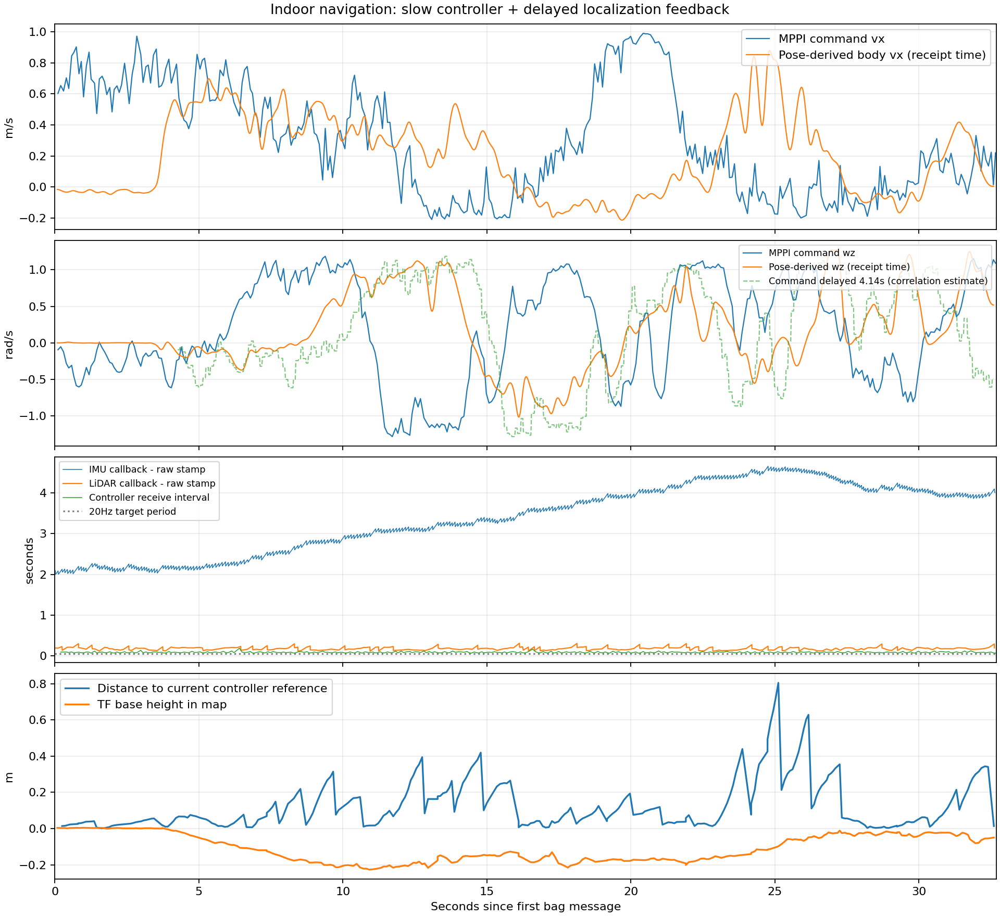
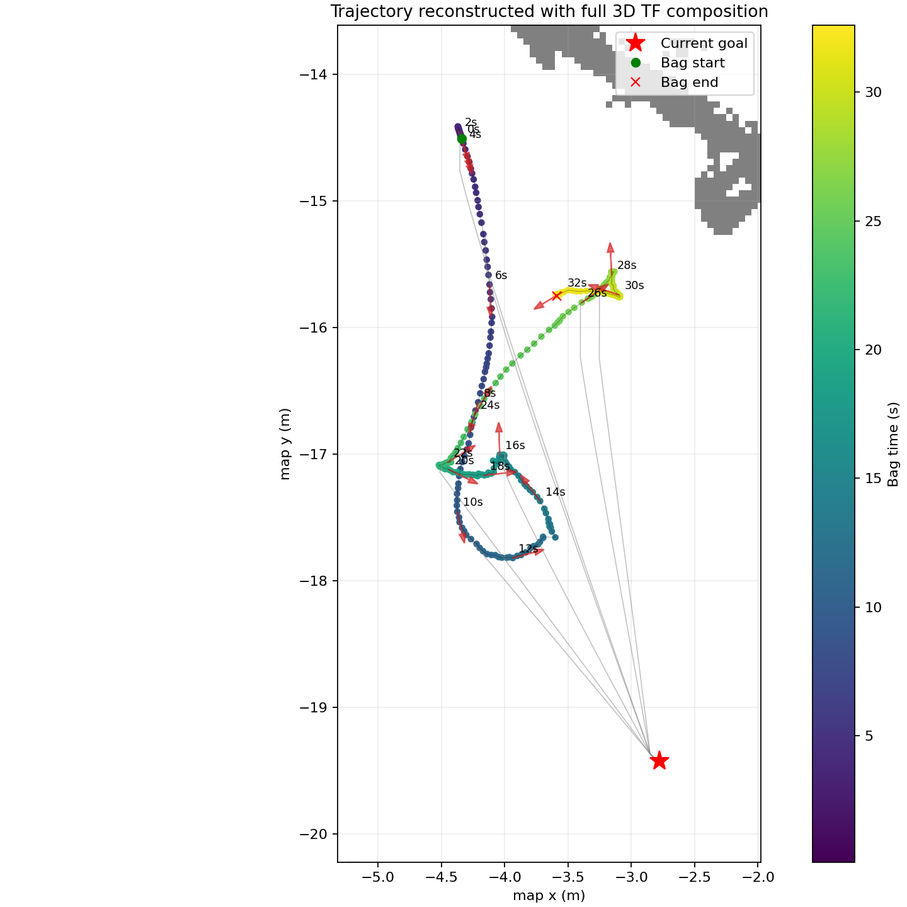
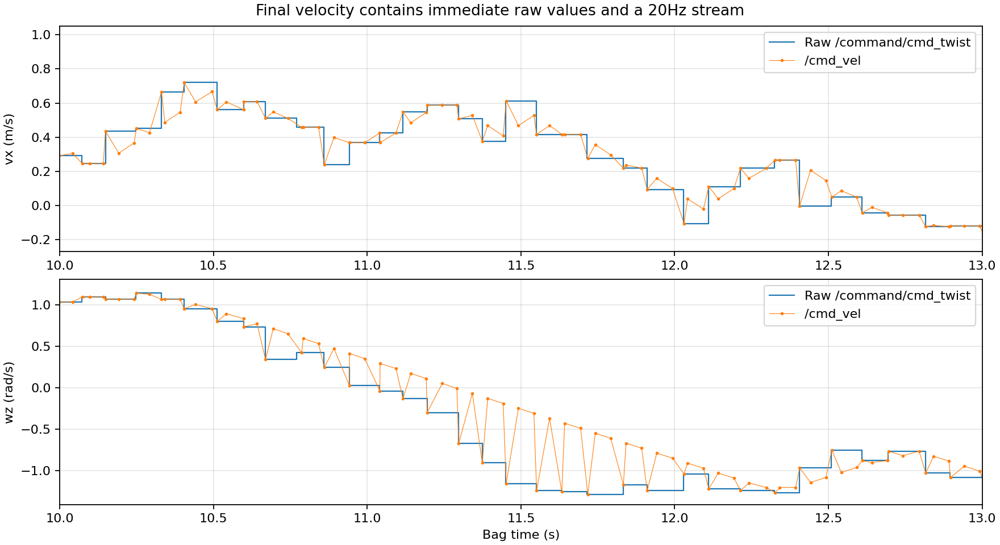

# 室内自动导航转圈分析：2026-11-02 19:50:00

**更新判断：用户补充同机 2D 导航表现良好。故障包中的秒级 IMU 时间差和控制器降频仍成立，但不足以认定 IMU 本身故障，或确定 IMU 异常是最初根因。应优先比较 2D 与 3D 的速度反馈来源、评分配置与新增负载，区分配置变化和负载诱发的反馈积压。**

分析对象为 `nav_elevation_2026-11-02_19-50-00`，时长 32.692 s，4983 条消息。时间均相对第一条记录消息。原数据库以只读模式打开，`PRAGMA quick_check` 返回 `ok`，SQL 话题计数与 metadata 一致。只新增本目录分析产物，未修改导航参数、定位程序或运行中的节点；未回放运动话题。

**用户进一步确认与当前工作范围**

用户确认 2D / 3D 实际都使用 FAST-LIO2 的 `/aft_mapped_to_init`，并观察到 RViz 中 MPPI 预测轨迹正确、执行时转圈，要求优先解决 MPPI 更新频率。此前根据仓库 YAML 缺省值推断实际速度反馈源不同，不能反映用户运行状态，现撤回该推断，不再将其作为 2D / 3D 差异归因。下面的配置差异表仅是文件审计记录。

当前工作聚焦已实测的约 11 Hz 原始控制输出、20 Hz 目标和周期超时。优化与测试记录单独保存在 `../mppi_frequency_2026-11-03/`。控制频率改善是否解决实机转圈，仍需用同场景的新录制验证。

**2D 正常这一对照改变了排查优先级**

用户确认 2D 导航整体正常，但尚未取得对应 2D 运行参数快照或 bag。当前仓库的 `scripts/start_navigation.sh` / `start_navigation_with_tf.sh` 使用 `2d_params.yaml`，与 HeightJump 配置存在以下已核对差异。这里是当前文件对比，不能自动等同于用户当时运行参数。

| 项目 | 2D 配置 | HeightJump 配置 |
|---|---|---|
| controller_server 的 odom_topic | 未显式设置；本机 OdomSubscriber 默认 `odom`，根命名空间通常解析为 `/odom` | 显式 `/aft_mapped_to_init`，故障包中 twist 全零 |
| MPPI 障碍评分 | ObstaclesCritic | 移除 ObstaclesCritic，加入 HeightJumpCritic |
| PathFollow / PathAlign 权重 | 10 / 10 | 15 / 15 |
| 局部地图 | 激光障碍层 + 膨胀层 | 只有占位膨胀层；当前已禁用；包内局部图全零 |
| 高程处理与高程消息 | 2D 不要求该组件 | 新增高程建图与数据消费 |

本机 `/opt/ros/humble/include/nav_2d_utils/odom_subscriber.hpp:64` 定义默认话题为 `odom`，并直接读取消息 twist。2D 配置在 BT / velocity_smoother 节点也写有 `/aft_mapped_to_init`，但这不会自动设置 controller_server 的独立参数。需要以正常 2D 运行时 `ros2 param get /controller_server odom_topic`、重映射和实际订阅者为准；也没有证据确认正常 2D 的 `/odom` 一定含有效速度。

HeightJump 评分按当前源码最多检查 1000 × 56 × 9 = 504000 个邻域查询/控制周期。既有本机合成基准的平地评分约 26 ms，仅说明该步骤可能占据 50 ms 控制预算的一部分；并非本次故障运行的分项耗时，不能直接用于归因。高程建图、共享算力与大消息录制负担也需要分别对照。

建议以正常 2D 为基线，先核对实际 controller odom 来源和有效 twist，再做单因素比较：保留 2D 导航参数增加高程建图/相同录制负载；然后在保留原有障碍层和其他参数的前提下单独增加 HeightJump 评分；最后才逐项引入纯 3D 配置差异。不能直接关闭纯 HeightJump 配置的唯一地形评分后自动行走。

- 若只增加高程建图/录制就出现 IMU 年龄增长或控制降频，优先定位资源竞争或接收积压。
- 若输入时间与频率正常，但增加 HeightJump 后才出现异常，优先检查评分耗时、通过/拒绝比例、地图边界和轨迹选择。
- 若只切换 odom 来源后出现异常，优先处理速度反馈来源及坐标系，不必先重写已能正常支持 2D 的 IMU 链路。
- `keep_zero` 与速度平滑器由两套模式共用，因此双路输出即使需要清理，也尚不能单独解释为什么仅 3D 转圈。

此前将“先修 IMU”作为确定方案，超出了证据边界；应先完成上述对照，再决定修复哪个模块。下面保留故障包的实测数据和机制分析。

**主要测量结果**

| 检查项 | 结果 | 含义 |
|---|---|---|
| IMU 回调日志时间 − 原始 IMU 时间戳 | 中位 3.588 s，P95 4.532 s，范围 2.003～4.654 s | 有秒级数据陈旧/时钟异常，不能用新发布的 odom header 排除 |
| 同一进程的 LiDAR 回调 − 原始点云时间戳 | 中位 0.178 s，P95 0.247 s | IMU 与 LiDAR 差异显著，不是两个传感器一起固定落后约 4 s |
| `IMU and LiDAR not synced!` | 6140 次，时间差中位 3.415 s，最大 4.506 s | 持续异常，发生在录包全过程 |
| 原始转向指令 → 定位姿态变化的相关延后 | 最佳约 4.14 s，相关系数从零延后的 −0.221 升至 0.699 | 支持闭环反馈严重滞后；不是独立测得的底盘执行延迟 |
| `/command/cmd_twist` 输出频率 | 11.031 Hz，配置/启动日志为 20 Hz | 实际周期约 91 ms，超出 50 ms 目标 |
| 原始指令间隔 | 中位 86.8 ms，P95 115.3 ms，最大 190.1 ms | 有控制性能问题，但量级小于 IMU 异常 |
| `Control loop missed ... 20Hz` | 245 次 | 约占原始输出次数的 68%；并非每一条告警都意味着丢掉了一条指令 |
| 原始指令与最近同值最终指令的记录时间差 | 中位 +1.18 ms，P95 +4.22 ms，最大 +16.03 ms | 转发不是秒级滞后的主要来源；少数负值反映录包跨话题接收顺序 |
| `/aft_mapped_to_init.twist.twist` | 306 条，六个速度分量全为 0 | 真实位姿有明显运动，Nav2 的速度反馈却一直是静止 |
| 高程图接收 − header | 中位 71.2 ms，P95 149.1 ms，最大 211.8 ms | 发布频率约 10 Hz；不代表其输入点云对应真实当前时刻 |



**转圈发生时，控制器与反馈的方向明显错位**

完整三维 TF 链为 `map → camera_init → aft_mapped → base_link`。用完整旋转与平移组合重建轨迹，避免把倾斜雷达坐标中的 z / yaw 直接当作底盘高度和航向。

- +0～4 s：MPPI 平均要求前进约 0.71 m/s，定位显示几乎未前进。这不是对底盘是否真的未移动的独立测量，可能正是旧位姿迟到。
- +10～14 s：定位反馈显示底盘航向累计增加约 204°，同时 +12～16 s 控制器平均在发负向转向约 −0.68 rad/s。
- +16～20 s：控制器平均转向约 +0.36 rad/s，而定位航向平均变化率约 −0.53 rad/s。
- TF 轨迹全程长度约 8.82 m，起终点净位移仅 1.45 m；累计绝对航向变化约 781°。当前目标距离从约 5.16 m 降至 3.76 m，包结束仍处于执行状态，不能当作成功到达。

这里的速度与航向变化率由定位位姿在接收时间上插值求导并做约 0.1 s 平滑得到；它们是定位反馈，不是独立真值。4.14 s 来自 0～6 s 延后扫描、20 ms 步长、最大 Pearson 相关系数，存在闭环耦合、变化延迟、底盘动态和短数据窗的影响。它适合说明秒级时序错位，不适合标定一个固定的底盘补偿常数。



这能形成如下失稳过程：机器人已经转向，但控制器仍读取几秒前的方向，继续加转向；等迟到的姿态反馈到达，已经转过头，再反向纠正。以约 1 rad/s 的指令计算，4 s 内对应约 229° 转角，量级足以解释明显绕圈。

**为什么 odom / TF 看起来“新鲜”，仍可能反馈过旧**

FAST-LIVO2 本机源码 `LIVMapper.cpp` 的 `publish_odometry()` 将 odom / TF 的时间戳写为发布时的 `now()`，不是被处理扫描的测量时刻。odom header 到录包接收的中位差只有约 4.8 ms，因此单独看这个差值会低估真实测量年龄。点云发布也使用 `now()`，高程图消息的新鲜度不能单独证明输入观测新鲜。

该行为还检查了本机已安装的 `fastlivo_mapping` 二进制：`publish_odometry` 中地址 `0x44494～0x444ac` 调用 `get_clock()` / `Clock::now()` 并写入消息时间。源码修改时间晚于二进制，因此其他实现细节以运行日志为主要依据，不能假定整个源码与当时二进制逐行相同。

当前源码的 `sync_packages()` 在 ONLY_LIO 分支等待 `last_timestamp_imu >= lidar_frame_end_time`，按队列头处理扫描。这与“IMU 落后 → 等待/处理旧扫描 → 当前时间戳包装旧状态”的链路相符；已安装二进制中也存在该 IMU / 扫描末时刻比较及等待分支（`0x4b4a4～0x4b4b8`）。

将每个 odom 发布 stamp 与其之前最近一条 IMU 回调日志中的 IMU stamp 比较，差值中位约 3.61 s、P95 4.55 s。**在源码/二进制所示等待逻辑、IMU 无额外未记录时间修正、日志与消息同属该进程的条件下，这给出被处理状态年龄的下界估计**，不是直接记录的扫描处理时间。

**IMU 侧更像有积压，但还不能定位到具体一层**

IMU 的“回调日志时间 − stamp”在录包开始约 2.1 s，+24～28 s 上升到约 4.5 s，结束约 4 s，明显不是一个固定偏移。回调实际处理约 188 Hz；IMU stamp 随日志时间推进的线性斜率约 0.919。这支持存在积压/消费速度不足，也需要排除驱动时间戳生成异常。

本机源码有两个值得优先测量的热点：IMU 订阅深度为 200000；同一个循环中调用 `spin_some()`、同步、估计和建图，并对每条 IMU 打印 INFO、不同步时再打印 WARN。它们可能放大排队和日志负担，**本包没有 CPU 性能采样，不能据此直接认定某一行就是唯一根因**。

包未录制 `/livox/imu` 和 `/livox/lidar` 原始输入，也没有驱动发布端与回调端的配对时间，所以无法进一步分清：驱动内部堆积、DDS/回调积压、还是原始时间戳异常。日志中的 `Self sync ...` 字样不能当成已完成同步；当前源码对应赋值是注释，期间也始终有不同步告警。

**另外三个应处理的问题**

1. **Nav2 速度反馈错误。** `/aft_mapped_to_init` 的 twist 六分量全零，位姿推导的转速绝对值 P95 却约 1.07 rad/s，前向速度绝对值 P95 约 0.61 m/s。当前控制器和 BT 配置把它作为 odom 输入。发布器源码只填 pose、未填 twist，与包中现象一致。修复时需明确速度所在坐标系和雷达/底盘的刚体外参，不能直接把世界坐标速度冒充底盘速度。这个问题会使控制器的速度状态输入失真；不能仅凭此认定它是唯一转圈原因。

2. **`/cmd_vel` 很可能混入两路输出。** 360 条原始指令均能在最终话题中找到毫秒级同值记录。除这些最近匹配点外，还剩 657 条，约 20.07 Hz。`keep_zero.py` 直接转发 `/command/cmd_twist → /cmd_vel`；外层 launch 全局重映射与本机 Nav2 自带 velocity_smoother 的输入/输出重映射叠加，符合“原始直通值 + 20Hz 平滑值”同时进入最终话题的结构。额外流相对最近原始角速度的差值绝对值 P95 约 0.54 rad/s，有 18 个记录点两者都超过 0.1 rad/s 且符号相反。Bag 的 Twist 没有 publisher ID，这里的发布者归因由消息模式和源码联合推断；需在复测时记录 `ros2 topic info /cmd_vel -v` 确认。最终运动输出应有明确、唯一的仲裁/平滑链路。

3. **MPPI 没达到设定更新率。** 源码参数当前 `controller_frequency=20`、`model_dt=0.05`，当时启动日志也明确 20Hz 并打开控制序列移动；实测约 11Hz。应对 MPPI、高程 critic、可视化及共享计算负载做分段计时，再决定降低负载或调整周期。不要只降低 `controller_frequency` 而不核对 MPPI 的模型步长/序列移动要求。



**目前不支持的解释及边界**

- 录包期间 Nav2 日志没有执行 spin 恢复行为、进度失败、HeightJump 地图过期或 TF 失败的记录，因此没有证据把本次转圈归为 BT 主动恢复旋转。
- 高程图持续约 10Hz 发布，接收时间与 header 最大差约 0.212 s。未见“高程图超过 1 秒未发布”触发失效的证据；但输入定位/点云可能本身是旧状态。
- 当时加载的是纯 HeightJump 配置：局部 costmap 仅 inflation 层，198 张录制局部地图全为 0。HeightJumpCritic 仍直接读高程图，不能因为局部图全零就排除地形评分对输出的影响；没有录到各 critic 的逐项代价。
- `/path.header` 沿用节点初始化时间，表面年龄约 366～399 s；这是累计轨迹外层 header 未更新，不能据此认定整条定位路径延迟数百秒。静态 `/map` 的旧 header 同理。
- 当时参数没有完整快照。日志能确认已加载 critic、阈值和控制频率；不能从当前 YAML 反推当时每个参数，特别是 TwirlingCritic 的 enabled/weight。仅调整防转圈权重会掩盖秒级反馈异常。

**故障链路的测量与修复候选（先执行前述 2D 对照）**

1. 先定位 IMU 时间异常。录制原始 IMU、LiDAR、定位及 TF；分别在驱动发布和 FAST-LIVO 回调入口测“当前时间 − 原始 stamp”，再记录本次处理的扫描末时刻和队列长度。驱动端新而回调端旧，重点查消费/排队；驱动端已经旧，重点查驱动/时间基准。降低逐 IMU 日志量，并用实测判断是否改善；时间偏差变化时不能用一个固定 `imu_time_offset` 硬补。
2. 保留真实测量时刻，使系统能检测过旧状态；需要当前时刻姿态时，应在正确时基上做 IMU 传播/融合，不能把旧状态 stamp 直接改为 now。IMU 队列策略应有积压检测与恢复机制，不能简单套用所有传感器 `keep_last(1)` 导致积分数据随意丢失。
3. 修复/提供正确的底盘速度反馈，并理清最终速度链路，验证只有预期的运动发布者。控制指令应经过唯一的仲裁与平滑路径。
4. 再分析 MPPI 各阶段耗时、恢复接近设定的控制频率；用小幅转向阶跃核对指令与独立底盘/IMU反馈的延后，最后复测短直线路径。先验证反馈恢复，再考虑调转向上限或 critic 权重。

**原始依据与复现**

- Bag：`nav_experiment_toolkit/bags/nav_elevation/nav_elevation_2026-11-02_19-50-00/`。
- Nav2：`/home/nvidia/.ros/log/component_container_isolated_8531_1793619849343.log`；第 126 行附近确认 20Hz，第 1440 行起为本包时段，245 条周期超时。
- 定位：`/home/nvidia/.ros/log/fastlivo_mapping_8016_1793619834795.log`；第 166535 行起为录包开始附近的 IMU / LiDAR 时间差。
- 本机定位源码：`/home/nvidia/wsnew/ws_livox/src/FAST-LIVO2-master/src/LIVMapper.cpp`，`imu_cbk`、`sync_packages`、`run`、`publish_odometry`。
- 转发：`src/keep_zero.py`；启动：`src/fishbot_navigation2/launch/navigation2.launch.py`；Nav2 内层重映射：`/opt/ros/humble/share/nav2_bringup/launch/navigation_launch.py`。
- 统计：`metrics.json`、`initial_metrics.json`；逐消息指令：`cmd_twist.csv` / `cmd_vel.csv`；完整 TF 位姿：`pose.csv`；原始日志时间：`imu_timing.csv` / `lidar_timing.csv`；相关扫描：`response_lag.csv`。

```bash
cd /home/nvidia/MPPI_3dnavi
source /opt/ros/humble/setup.bash
source install/setup.bash
/usr/bin/python3 docs/analysis/indoor_spin_2026-11-02_19-50-00/extract.py
/usr/bin/python3 docs/analysis/indoor_spin_2026-11-02_19-50-00/analyze.py
```

提取程序只读 bag 并将中间缓存写到 `/tmp/mppi_indoor_spin_data.pkl`，第二步生成本目录统计和图片。定位历史以已录数据为准，不需要启动导航或底盘。体量较大的 `/trajectories` 仅统计数量，不做反序列化；其他录制话题均进行 CDR 解码。
