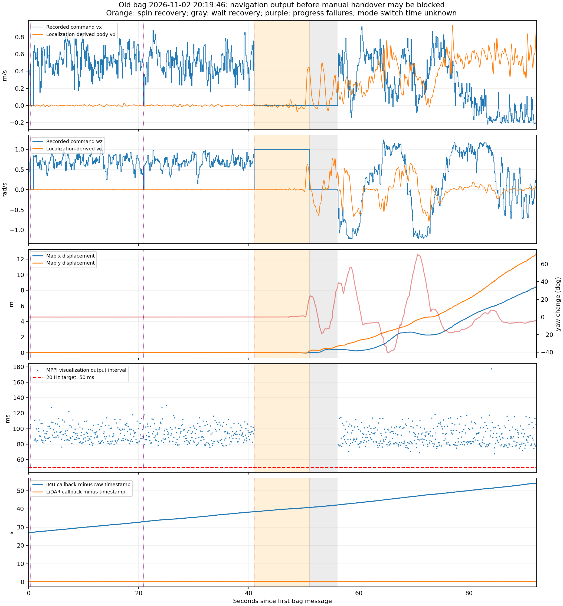
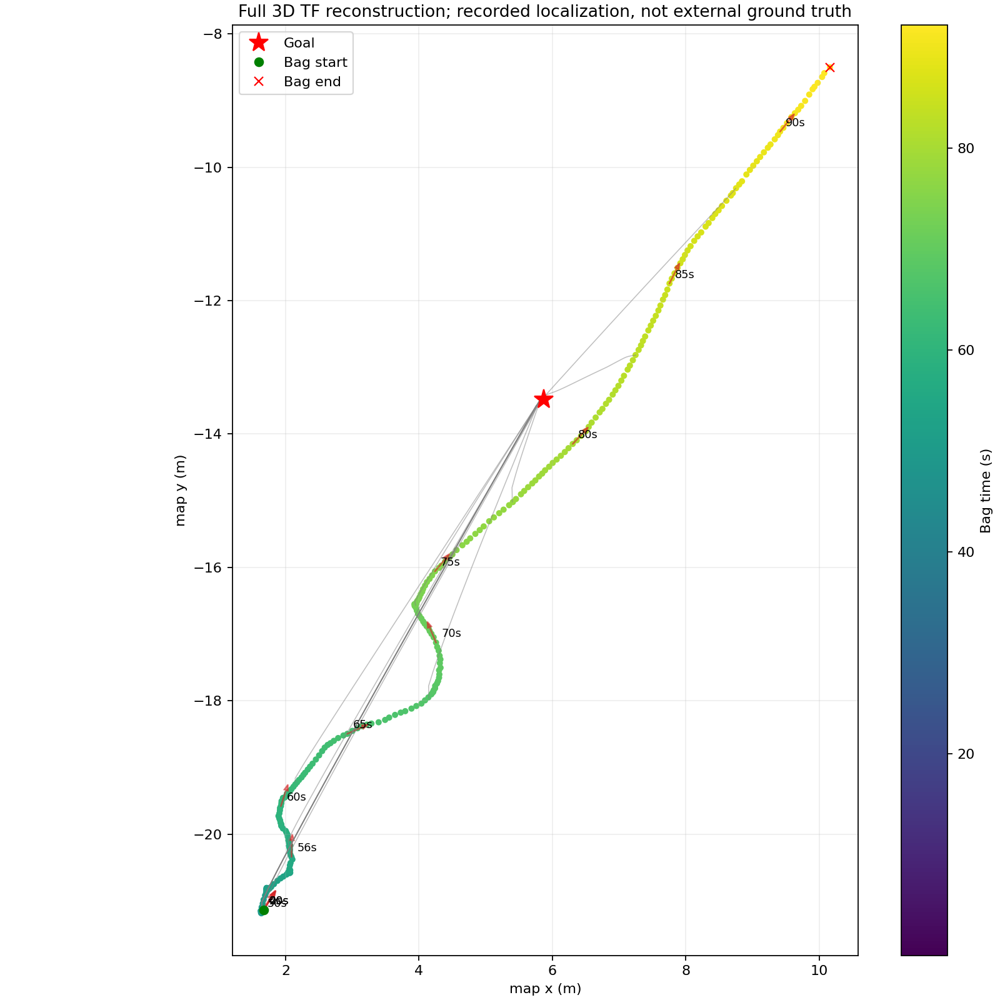

# 旧包平地转圈分析：nav_elevation_2026-11-02_20-19-46

分析日期：2026-11-04。只读取录包与同一时段日志，未启动导航或发布运动指令，未修改运行配置。

## 结论与证据等级

**根据用户补充的手动/导航切换流程修正结论：发送导航终点后，用户仍保持手动模式，等待几十秒才允许导航控制底盘。这个等待足以触发 Nav2 的无进展检查和旋转恢复。** Nav2 接受目标就开始执行，不会自动等待遥控器切换；若切换发生在旋转恢复阶段，底盘会开始执行恢复旋转。包内没有模式切换记录，不能确定实际交接发生在哪一秒，或把全部后续转圈唯一归因到这一机制。

前约 41 s 虽然持续存在导航速度指令，定位平面位置范围仅约 1.1 cm、航向范围约 0.085°，但在手动模式屏蔽导航输出、实物静止时，这是符合操作流程的现象。**撤回把这段静止直接当作定位反馈迟滞的主要证据。**

MPPI 降频仍然独立成立：活跃输出约 10.9 Hz、周期约 90 ms。这项性能问题需要与提前发送目标导致的任务状态变化分别验证。

匹配的 FAST-LIVO 日志中，IMU 回调入口打印的原始消息时间比回调日志时间落后约 27～54 s，且差距不断扩大；LiDAR 的对应差值仅约 0.19 s。此项时间推进异常独立存在，仍需区分上游积压与时间基准异常。**27～54 s 不能直接称为底盘执行延迟或定位状态年龄，也不能再结合手动等待期间的静止反馈来认定转圈由定位延迟造成。**

本包三次真实 FollowPath 中止均为 `Failed to make progress`，没有 `Optimizer fail to compute path`。第 40.98～50.99 s 确实运行了 Nav2 旋转恢复。已确认的机制是无进展后主动恢复；是否在恢复期间切入导航，缺少模式时间戳，尚不能直接确认。

用户确认 2D / 3D 都采用 `/aft_mapped_to_init`，本分析不推断二者里程计来源不同。这里的异常来自该次运行记录，不能仅由此归因到 IMU 硬件或 FAST-LIO 算法本身，也不能说明 2D 运行有同样问题。

## 数据范围

- 包目录：`nav_experiment_toolkit/bags/nav_elevation/nav_elevation_2026-11-02_20-19-46`。
- 实际录制时间约 2026-11-02 20:19:47.485～20:21:19.714，持续 92.2286 s，共 12607 条消息。
- Nav2 日志：`/home/nvidia/.ros/log/component_container_isolated_14850_1793621885194.log`。
- 定位日志：`/home/nvidia/.ros/log/fastlivo_mapping_14348_1793621870425.log`。
- 所有相对时间均从第一条 bag 消息算起；与回放倍率无关。该包为优化前运行，不以当前源码性能反推旧运行耗时。

## 1. MPPI 实际更新明显不足

`/trajectories` 有 832 次成功优化后的显示输出。排除大于 0.5 s 的恢复/重试空档，其相邻输出间隔为：

| 指标 | 实测 |
|---|---:|
| 活跃输出频率 | 10.86 Hz |
| 周期 P50 | 90.12 ms |
| 周期 P95 | 111.75 ms |
| 周期 P99 | 117.59 ms |
| 活跃间隔最大值 | 177.59 ms |
| 目标周期 | 50 ms / 20 Hz |
| 同期控制周期超时告警 | 570 次 |

分段输出率约为 10.47、10.72、11.03 Hz；第一段包括一次约 0.58 s 的清图重试间隔。不能直接用 92 s 全包平均频率衡量控制计算，因为包内包含旋转恢复与等待。

旧可视化非常重：`/trajectories` 单条平均 933.45 KiB，合计 758.42 MiB；点云合计 527.93 MiB，高程图合计 34.72 MiB。消息量和超时告警证明存在负载，但旧包没有 CPU profile，不能把每个超时精确分摊给显示、HeightJump、建图或录包。先前离线优化的因果对照单独保存在 `../mppi_frequency_2026-11-03/` 与 `../heightjump_implementation_2026-11-03/`，不属于本包实测。

## 2. 前约 41 s：导航输出存在，实际控制权尚未确认

完整组合 `map → camera_init → aft_mapped → base_link` 三维 TF，不能只对相机坐标系 x/y 或 yaw 作平面相加。该包 `map → camera_init` 恒定；TF 与 odom 的逐帧 header、位置完全一致。

| 阶段 | 平均指令 vx / wz | 定位 x / y 范围 | 定位航向范围 |
|---|---:|---:|---:|
| 0～20.888 s | 0.530 m/s / 0.695 rad/s | 1.02 / 0.98 cm | 0.054° |
| 20.888～40.954 s | 0.494 m/s / 0.684 rad/s | 1.01 / 0.91 cm | 0.078° |

合并前 40.954 s，定位 x/y 各自范围约 1.10/1.09 cm，航向范围约 0.085°。这些是范围，不能把厘米级噪声累积得到的路径长度误认为有效移动。该阶段速度指令积分约 20.64 m、27.77 rad；它们只是指令积分，不能当成实物位移和转角。

用户补充：选好起点和终点后，通常保持手动模式几十秒，等稳定后才切导航。**因此该阶段完全可能是机器人静止、Nav2 指令尚未获准执行，定位正确报告静止。** 速度话题有输出不代表底盘接受了该输出。原分析以此怀疑反馈迟滞的推断条件未得到满足，应撤回。

Nav2 仍在执行 FollowPath，每 20 s 检查不到超过 0.2 m 的平面位移就会失败，重试/恢复继续消耗时间。发送新路径进行重规划通常不会重置当前进展检查基准。切换遥控器模式本身也不会自动重新建立一个干净的导航任务；应通过取消旧任务、切换后重新发送目标来验证。

包里没有模式开关、独立轮速或视频真值，不能精确划定人工交接时间。图和阶段指标描述 Nav2 输出/行为状态，不代表底盘当时已经处于自主模式。

## 3. 上游原始时间推进异常，不能只看 odom header

同一定位进程日志的统计：

| 项目 | 结果 |
|---|---:|
| IMU 回调样本数 | 13019 |
| IMU 回调墙钟跨度 | 92.186 s |
| IMU 原始 header 推进 | 65.099 s |
| 回调处理率 | 约 141.2 Hz |
| IMU header 对墙钟推进斜率 | 约 0.713 |
| 原始 IMU 时间差 P50 / P95 | 39.53 / 52.28 s |
| LiDAR 回调时间差 P50 / P95 | 0.192 / 0.264 s |
| IMU / LiDAR 不同步告警 | 13019 次 |

代表点：

| bag 时间 | IMU 原始 header 相对 bag 开始 | 回调日志时间减原始 header |
|---|---:|---:|
| 0.03 s | -26.95 s | 26.98 s |
| 20.00 s | -12.71 s | 32.71 s |
| 39.95 s | 1.76 s | 38.19 s |
| 60.06 s | 16.55 s | 43.51 s |
| 91.93 s | 37.94 s | 54.00 s |

这不是一个可用固定 offset 补偿的恒定时间差。可能原因包括驱动内部排队、DDS/回调消费不足、消息时间戳基准或生成速度异常，当前数据无法最终定位到其中一层。

odom 的接收减 header 中位数只有 5.05 ms，不能据此证明测量新鲜。本机对应 FAST-LIVO 源码 `publish_odometry()` 使用 `now()` 填写 odom/TF 时间戳，而不是被处理扫描的测量时间；此前已独立检查已安装二进制确认这一行为，见 `../indoor_spin_2026-11-02_19-50-00/report.md`。源码其余实现细节可能晚于旧二进制，具体输入时间与实际处理扫描仍需新采集的埋点验证。

本机源码还存在 200000 深度的 IMU/LiDAR 订阅队列、逐 IMU INFO/WARN 日志，以及按扫描队首等待 IMU 的同步逻辑。这些是待测量的积压风险，不能仅看源码就断定某一项为唯一根因。`Self sync ... HARD time lag` 的打印也不能证明已经完成同步。

## 4. ABORTED 和旋转恢复的实际时间线

| 相对时间 | 事件 | 日志行 |
|---|---|---:|
| +0.351 s | `Failed to make progress`，随后结束 FollowPath | 707 |
| +20.888 s | 再次 `Failed to make progress` | 883 |
| +40.954 s | 第三次 `Failed to make progress` | 1062 |
| +40.978 s | `Running spin`，目标转角 1.57 rad | 1064 |
| +50.986 s | spin 超过 10 s 允许时间而中止 | 1066～1068 |
| +50.999 s | 开始 wait | 1069 |
| +56.00 s | wait 完成，随后重新执行 FollowPath | 1070～1071 |

第一条真实失败发生在包开始后仅 0.35 s，说明录制时已经处于此前任务执行中，不能认为机器人刚开始导航 0.35 s 就被 20 s 检查器判失败。

旋转恢复段 `/command/cmd_twist` 为 `vx=0`、`wz≈1 rad/s`，约 10 Hz；这个频率是 behavior server 的恢复输出，不是 MPPI 更新频率。该段没有 `/trajectories`。恢复期定位净航向变化约 19.4°，因此未按定位反馈达到 90° 目标而超时。

包内没有 `Optimizer fail to compute path`、`Controller patience exceeded`、`HeightJump unavailable` 或 `HeightJump TF` 告警。真实 abort 触发点是无进展，并无证据表明 HeightJump 把全部轨迹拒绝后让 MPPI 失败。`/follow_path/_action/status` 还有重规划替换旧目标产生的 aborted，不能把所有 status=6 都统计为控制失败。

`/navigate_to_pose/_action/status` 录到的是 EXECUTING，包结束没有导航终局结果；不能凭这包声称导航成功或最终失败。

## 5. 指令转发与高程图

937 条 `/command/cmd_twist` 都能在 `/cmd_vel` 中找到相同值；录包接收时间差中位数 1.13 ms、P95 3.87 ms、最大 15.26 ms。说明这两条记录之间没有明显秒级转发积压；这是 recorder 侧匹配，不是底盘接收/执行时间。

去除匹配值，`/cmd_vel` 还剩约 20.16 Hz 的流，和当前平滑/转发结构相符。存在少量与最新原始转向指令反号的样本（|wz|>0.1 的 15 条），但发布者身份未录制，不能从 bag 精确归属；这属于另一个待审查的指令链路问题。`/cmd_vel` 全包约 30 Hz 不能用来说明 MPPI 达到了 20 Hz。

高程图约 10 Hz；成功 MPPI 显示输出时，recorder 已见到的最新地图 header 年龄 P50 137 ms、最大 297 ms，未接近当前 1 s 超时阈值。这不等价于地图真实传感器观测只有 137 ms，也不代表能观察 critic 回调队列；但与没有地图不可用/优化器失败日志一致，不能把本次 abort 归为地图超时。

`/aft_mapped_to_init` 的 twist 六分量全为零，这会使控制器接收到的速度状态与实际 pose 变化不一致。用户的 2D 也用同一话题，因此这项不能单独解释 2D / 3D 差异。

## 6. 响应相关性不提供唯一底盘延迟

对指令角速度和定位航向求导作 0～10 s 的探索性相关扫描：56.5～92 s 的最大相关约在 1.92 s，60～75 s 在 2.00 s，但 75～92 s 的最大值落在搜索边界 10 s；前 40 s 反馈几乎不变，没有有效相关。窗口选择明显影响结果，闭环控制、恢复、平滑、异步输入和时间戳异常均会混入。

因此这里不报告一个“精确的底盘延迟”，也不据此加入 2 s 固定补偿。用户补充后，模式交接时间未知是额外的关键混杂因素。可靠判断为控制降频、原始输入时间推进异常，以及已实际发生的无进展失败/旋转恢复；手动等待期间的指令与静止反馈不再作为定位迟滞证据。

## 7. 下一步应如何验证

1. 优先校正操作顺序：取消并结束旧导航任务；在手动模式完成定位与稳定；切入导航模式后重新发送导航目标。若需要提前选择终点，应设计仅预览、显式开始时才发 action 的流程，不能把已发送目标视为暂停。
2. 使用已优化的 MPPI / HeightJump，保留同样采样数、运动模型、路线和显示负载重新录制平地测试；比较实际自主运行阶段的输出间隔与超时告警。
3. 新包必须记录手动/导航模式及切换时刻，再加入原始 `/livox/imu`、`/livox/lidar`、底盘独立速度/IMU、原始控制输出与最终指令；同步记录驱动发布、定位回调入口、实际处理扫描末时刻和队列长度，区分时间基准错误与消费不足。
4. 把“任务何时开始/底盘何时接受控制”与“传感器、计算、转发和执行时延”分别测量。本包不能证明仅优化 MPPI 就已解决转圈，也不能在缺少切换时刻的情况下证明所有转圈都来自恢复机制。





## 复现与文件

```bash
cd /home/nvidia/MPPI_3dnavi
source /opt/ros/humble/setup.bash
python3 docs/analysis/indoor_spin_2026-11-02_20-19-46/extract.py
python3 docs/analysis/indoor_spin_2026-11-02_20-19-46/analyze.py
```

提取缓存位于 `/tmp/mppi_indoor_spin_201946_data.pkl`，不会覆盖另一个旧包的缓存。`metrics.json`、`initial_metrics.json`、`pose.csv`、`cmd_twist.csv`、`cmd_vel.csv`、`phase_metrics.csv`、原始输入日志时间 CSV 和 `response_lag.csv` 保存可复核数据。所有 SQL 都用只读连接；脚本不创建 ROS 节点或运动指令发布者。
