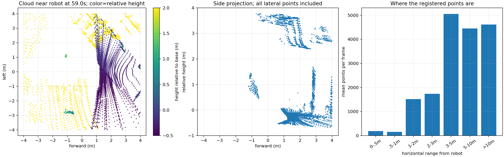

# 局部导航点云密度与用途分析

2026-11-04。只读取配置、源码和旧包 `nav_elevation_2026-11-02_20-19-46`，均匀抽样 48/651 帧 `/cloud_registered`。这不是刚修改重力初始化后的现场效果，也没有原始 LiDAR 包，因此不能据此判定雷达丢包或硬件故障。

## 结论

点云总量不是极少，但大量点分布在局部地图之外和高处，真正近场地形的单帧覆盖明显少于总点数。当前约 34° 的雷达俯装使前方更容易观测地面、后方主要朝上；滤波无法补出本来没有观测到的后方地面。

应分别处理视场/安装造成的缺测、导航分支的点云筛选，以及高程图已有过滤的传感器原点语义。增加累计时间、提高消息发布频率或减少 LIO 体素尺寸，都不能单独解决这些问题。

## 实测

按完整三维 TF 将点转换到 map，再减去机器人位置。7×7 m 方框以机器人为中心、与地图轴平行，是滚动地图 ROI 的近似；不是每一帧 GridMap 的实际边界。高度均相对 base_link，不能自动视为地面高度。

| 抽样指标 | 中位数 |
|---|---:|
| 单帧总点数 | 17650 |
| 机器人周围 7×7 m 内点数 | 6119.5 |
| 方框外比例 | 65.55% |
| 方框内高于 base_link 1.5 m 的点数 | 1946 |
| 方框内 −0.5～1.5 m 示例高度带内点数 | 3920.5 |
| 上述示例高度带做 5 cm 体素后的点数 | 2423 |
| 上述示例高度带做 10 cm 体素后的点数 | 1194.5 |

48 帧未发现非有限 XYZ。全包 registered 点云输出约 7.05 Hz；这不是原始雷达数据发布频率。

按所有抽样点统计，平均约 53.86% 高于 base_link 2.5 m；这说明高处数据很多，不能仅凭高度给它们全部贴上“噪声”标签。它们可以是实际墙体/天花板等结构，对定位仍可能有用。

单帧近场点投影到 10 cm 网格，已占据 XY 格数中位数约 1766.5；这些格子可能来自墙和障碍，不等于已确认地面/自由空间。基准 z 附近的点也不能直接全部当作地面。示例高度带与体素尺寸只是处理量估算，**不是已验证可直接上线的安全过滤阈值**。

## 安装与视场

旧包静态 TF `base_link → line_frame → livox_frame` 的合成俯仰约 +33.976°。MID-360 官方垂直视场为 −7°～52°，水平 360°。

按该外参、机身水平和官方标称视场计算：

| 方位 | 相对机身水平面的射线俯仰范围 |
|---|---:|
| 正前方 | 约 −40.98°～18.02° |
| 正后方 | 约 26.98°～85.98° |

因此后方射线全部朝上，不会直接命中同一高度以下的平地。前向俯装提升前方近地面观测，但不是机器人周围所有方向都有相同近地面覆盖。实际安装若与 TF 不符，需要先校准外参；不能仅用此计算声称已经测量过机械安装。

若主要前进，这种俯装有其用途；若要求后退、原地转向时的全向近场地形可见，需要通过安装视场设计、传感器布局或有时间有效性管理的历史观测解决。未观测到的区域不能通过插值或放行 unknown 自动变成已确认可通行区域。

MID-360 官方点率为 200000 点/s（首回波）、典型帧率 10 Hz。按这两个名义指标估算约 20000 点/帧；当前 registered 帧约 1.6～2.0 万点的量级不足以证明输出异常。原始接收、预处理、去畸变和输出频率需要分别测量，不能把这些指标直接混为一条无损管线。

## 当前处理链

当前配置：驱动 `publish_freq=10.0`，FAST-LIVO `point_filter_num=1`、`blind=0.4`、`filter_size_surf=0.1`、`dense_map_en=true`、相机关闭。

按本机当前 `LIVMapper.cpp:513`：

```cpp
PointCloudXYZI::Ptr laserCloudFullRes(dense_map_en ? feats_undistort : feats_down_body);
```

因此 `dense_map_en=true` 当前选择去畸变完整点云，不是 10 cm 体素后的 `feats_down_body`。`preprocess.cpp` 非特征提取分支使用 `valid_num % point_filter_num == 0`，值为 1 不作这一步抽点。仍存在近距离、line 等预处理条件。配置文件有些“官方”注释与本机该分支的实际实现不符，调参应以本机实现为准。

据此，不能把当前 registered 点稀疏直接归给 `filter_size_surf=0.1`，也不应只把这个参数减小就期待导航点云变密。上述是当前配置/源码审计，旧包没有参数快照，不能证明旧运行全部参数逐项相同。

`pcl_to_scan.launch.py` 的高度和 6 m 距离限制只作用于 `/scan` 转换，不会替高程图过滤输入。raw elevation 直接订阅 `/cloud_registered`，本身已有距离及随距离变化的高度门限，但缺少专门导航分支的明确 ROI/自体过滤。

## 需优先注意的高程输入原点语义

当前绑定到容器的源码 `elevation_mapping_node.py` 把 `map ← camera_init` 的平移传给 `input_pointcloud()`；输入 `/cloud_registered` 已经位于固定 camera_init。该平移代表 camera_init 原点在 map 中的位置，不是当前雷达原点。

核函数同时把这个 t 用于距离噪声、距离/高度有效性和射线清理。这会在机器人远离初始原点后改变过滤/清理几何。该问题已在早先点云分析中确认，详见 `../teleop_flat_2026-10-19_20-47-37/report.md`。本轮读取的源码目录通过 Docker bind mount 映射 `/home/nvidia/elevation_map → /root/elevation_map`，但没有重新启动或修改容器。

因此应先纠正点云坐标变换与当前传感器原点这两个不同语义，再判断进一步过滤的效果；不能只叠加更强滤波来掩盖坐标语义问题。本轮没有修改该外部仓库。

## 推荐处理次序

1. 检查真实安装与 TF 一致，明确近场前/后/侧方需要覆盖的区域；先识别物理盲区。
2. 修正高程融合使用的当前传感器原点，分别保留点云 frame 变换和射线起点。
3. 保留 LIO 所需的完整观测，增加独立的导航点云分支：地图 ROI、经实测的机身自体过滤、按机身净空与坡道需求确定的高度范围、必要的轻量体素过滤。
4. 保留地面、台阶、坡面、低矮/细小障碍物，不将地形导航当作普通“删除地面”的障碍点云处理；强邻域离群过滤可能反而删掉稀疏的小障碍。
5. 利用已有高程融合或有位姿/时间补偿的短时积累改善静态覆盖，保留动态清理；不为了画面密集而等待 1 s 才输出一帧，也不把补洞当成新观测。
6. 新数据记录原始 `/livox/lidar`、`/livox/imu`、registered、导航过滤输出、TF 与高程图，比较近场点数、有效地形覆盖、处理耗时和传感器年龄。改变驱动分帧频率通常只重分配每帧点数，不能凭空提升硬件点率。

本轮为分析，没有新增导航过滤节点或更改雷达参数。图中旧包的位置来自定位而非独立真值，最近 TF 的 recorder 接收差值也在 `frames.csv` 中保留；个别帧约 0.16 s 的配对差异使移动阶段 ROI 统计只是近似，不能用作精确障碍边界评价。



## 复现

```bash
cd /home/nvidia/MPPI_3dnavi
source /opt/ros/humble/setup.bash
# 先运行旧包提取以建立分析缓存（如果缓存尚不存在）
python3 docs/analysis/indoor_spin_2026-11-02_20-19-46/extract.py
python3 docs/analysis/navigation_cloud_2026-11-04/analyze.py
```

产物：`metrics.json`、`frames.csv`、`analysis.log`、`cloud_density.png`。SQL 连接只读，没有初始化 ROS 节点或发布速度。

参考：[Livox MID-360 官方规格](https://www.livoxtech.com/mid-360/specs)。
