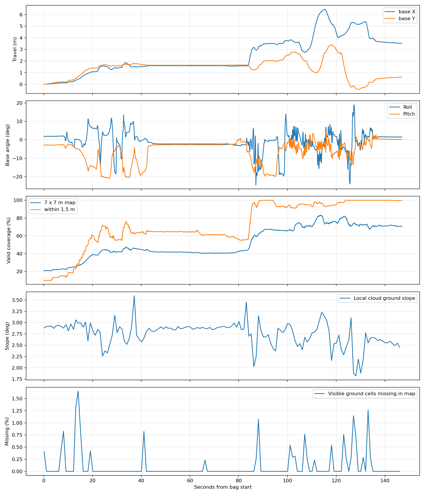
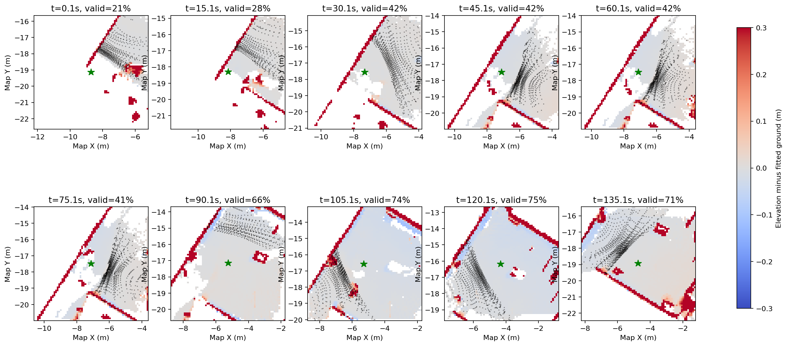
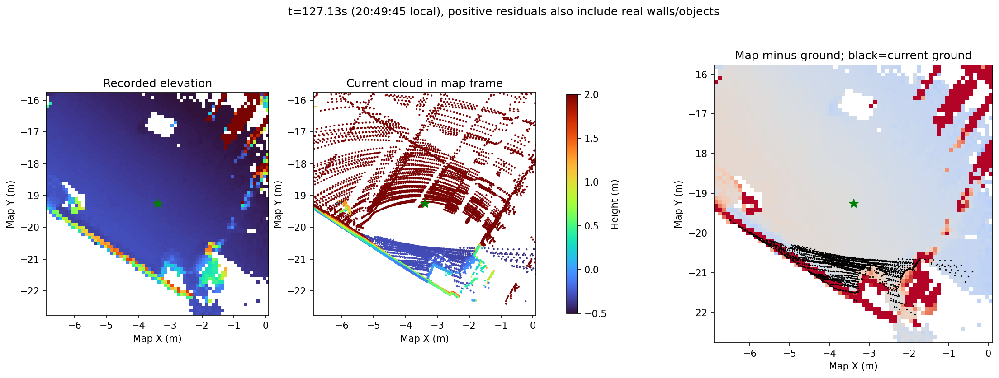

# 遥控平地记录：点云与高程图更新分析

分析对象：`rosbag_recording/bags/terrain_elevation/teleop_flat_2026-10-19_20-47-37`。

实际包时间为北京时间 2026-10-19 20:47:38.234–20:50:05.248，共 147.014 秒。本文的秒数均相对包起点。按遥控感知实验评价，不评价自主导航或 MPPI 控制效果。未修改建图、TF、导航源码和运行参数。

后续针对本体升降、坐站初始化的专项核验见 [本体高度稳定性报告](../body_height_stability/report.md)，其中区分了动态位姿补偿、初始化基准与动态高点输入。

## 结论

**这份记录没有显示点云断流或高程图长期停止更新。大部分可见地面进入了高程图；前半段大片空白主要与当时没有地面观测的区域对应，转向后覆盖增加。**

同时发现两处明确的源码接入问题：

1. **注册点云的固定坐标系原点被当作传感器原点。** 点的位置变换可以正确，但测距噪声、距离/高度过滤、可见性射线清理不再对应当前雷达位置。包内计算表明该区别已经达到数米，不能忽略。
2. **发布的地图中心与内部按格移动的中心不一致。** 当前实现会把栅格放在连续机器人位置附近显示，产生数厘米的空间偏移，影响墙边和台阶边缘对齐。

另外，局部高值存在与新地面观测不一致的候选；地面在 `map` 中仍呈约 2.8°的坡度。这两项需要分别排除真实物体/遮挡与真实场地坡度，不能仅凭这份包归结为单一根因。没有做修复前后重建对照，因此不将上述代码缺陷直接认定为所有现象的已证实原因。

## 1. 更新链路实际情况

| 检查项 | 结果 | 判断 |
|---|---|---|
| 注册点云 | 1470 帧，全部在 `camera_init`；每帧约 1.23–2.11 万点，无 NaN/Inf | 输入持续存在 |
| 里程计 | 1470 帧 | 与点云数量相当 |
| 高程图 | 1470 帧，`map`，7×7 m，0.1 m 分辨率，`elevation/variance` | 输出持续存在 |
| 点云接收间隔 | 中位数 98.3 ms，最大 206.3 ms | 未见长时间断流 |
| 地图接收间隔 | 中位数 100.0 ms，最大 140.6 ms | 接近目标 10 Hz |
| 地图源时间戳 | 37 次相邻重复，0 次倒退，最大相邻前进间隔 256.7 ms | 少量重复发布，未见持续冻结 |
| 地图接收时间减 header 时间 | 中位数 52.1 ms，P95 79.8 ms | 消息年龄近似值，不能当作融合计算耗时 |
| 相邻地图完整 elevation 数组完全相同 | 1 对 | 数组在变化，但这项本身不能证明每格都融合了新观测 |
| 可见地面格在地图中缺失 | 147 个约 1 Hz 样本；每帧缺失率中位数 0%，P95 0.81%，最高 1.65% | 有地面观测的位置大多已有高程 |

地面对应检查使用机器人周围 2.5 m 内的候选点，RANSAC 拟合局部低坡度平面；距离平面不超过 4 cm 的点作为地面观测，再按 GridMap 几何查格。GridMap 按 `column_index/row_index` 解码，并使用循环索引；本包循环索引均为 0。147 帧中的绝大多数能按相同源时间戳配对，少数使用最近地图，最大时间差约 75 ms。

地面格与点云的每帧绝对差中位数，再跨 147 帧取中位数，约 **2.8 mm**。这个数只表示同一条输入输出链路的对应程度，**不是独立真值下的建图精度**，也不覆盖边缘和高值残留。

## 2. 为什么有些区域看起来没有更新

全图有效比例从开始约 **21%**，提高到后段约 **70%**，最高 **83.2%**。机器人周围 1.5 m 的有效比例从最低 **10.1%** 提高到后段接近 **100%**。

单帧点云中的地面回波主要集中在一侧的扇形区域，机器人周围并非每个方向都能即时看到地面。当前录下的安装 TF 包含约 34°俯仰，姿态和朝向变化也会改变地面视野。没有新观测的空格不会凭空填满。

约 **42–80 s**，机器人整体位置变化较小，地图覆盖维持约 **40–45%**；原有地面点云和 elevation 仍在变化。这段不能依据覆盖比例近乎不变就判断建图卡死。约 **85–95 s** 开始移动/转向后，覆盖率提高到约 **65%**。

地图边长只有 7 m，移动时窗口外的区域退出显示也是预期行为。查看 RViz 时应同时观察当前点云是否照到空白区域，再判断是否漏融合。





第二张图：黑点为当帧近似地面观测，绿星为机器人，白色为无有效 elevation，颜色是地图高程减局部拟合地面。红色也包括真实墙体和物体，不能全部解释为误差；各小图以各自滚动窗口为中心。

## 3. 确认的源码问题：固定原点参与传感器模型

输入 `/cloud_registered` 已经在固定 `camera_init` 坐标系中。包里的 `map -> camera_init` 全程固定；机器人和雷达在这个固定系中运动。

当前节点 `pointcloud_callback()` 用 `map <- camera_init` 的 R、t 变换注册点云，随后把同一个 t 传入 `input_pointcloud()`。核心核函数同时执行：

- `point_noise(rx, ry, rz)`：用输入点到输入 frame 原点的平方距离建立噪声；
- `is_valid(x,y,z,t)`：用 t 作为传感器位置进行距离/高度过滤；
- `ray_vector(t, point)`：从 t 出发进行可见性清理。

上述射线清理受 `enable_visibility_cleanup` 控制；当前源码配置默认开启，但本包缺有效参数快照，不能确认当时的开关。距离噪声与原点语义的问题可直接从输入路径确认。

因此这里的 t 表达的是 **camera_init 原点在 map 中的位置**，并不是当前雷达原点。坐标变换正确并不能消除这一语义错误。

使用包中 `map -> camera_init -> aft_mapped -> base_link -> line_frame -> livox_frame` 重建雷达位置，得到：

| 时刻 | 固定原点与雷达位置距离 | 近处地面真实雷达距离中位数 | 到 camera_init 原点的距离中位数 | 平方距离噪声比中位数 |
|---|---:|---:|---:|---:|
| 60.1 s | 2.00 m | 1.05 m | 2.69 m | 6.51 倍 |
| 110.1 s | 3.99 m | 1.31 m | 4.92 m | 14.48 倍 |
| 127.1 s | 5.12 m | 1.46 m | 5.25 m | 13.84 倍 |

147 个样本的平方距离噪声比中位数约 **6.24 倍**，最大样本中位数约 **24.67 倍**。比值是对每个地面点计算后再取中位数，不是表内两个距离中位数之比。雷达位置以包内 TF 为准，未独立验证机械外参。

这会改变新观测在融合中的权重，并让清理射线和高度过滤相对错误的原点工作。**这是当前代码可确定的问题；对每块残留/缺测造成多大影响，还没有修复重放对照。** 参数快照文件为空，表中的平方距离比不依赖 `sensor_noise_factor` 的具体值，但不能据源码配置冒充当时实际参数。

代码位置：

- `/home/nvidia/elevation_map/src/elevation_mapping_cupy/elevation_mapping_cupy/elevation_mapping_cupy/elevation_mapping_node.py:960`，点云 frame 变换与输入；
- 同目录 `kernels/custom_kernels.py:66`，`point_noise()`；`:79`，有效性检查；`:210` 附近，可见性射线；
- `/home/nvidia/wsnew/ws_livox/src/FAST-LIVO2-master/src/LIVMapper.cpp:1196`，注册世界点云发布。

修正方向：保留注册点坐标，同时显式传入当前真实传感器原点；或先把注册点云按对应位姿反变换到当前传感器系，再交给现有传感器模型。不能只改 `frame_id`，也不能把当前雷达平移直接替换进世界点变换而造成二次平移。

## 4. 确认的源码问题：地图发布中心没有对齐内部中心

`ElevationMap.move_to()` 把 XY 位移取整到 0.1 m，再移动内部数据和内部中心；但 `publish_map()` 已读取内部 `center` 后，仍优先用 `_map_t.x/y`（连续机器人位置）发布 GridMap 的位置。

结果是数据对应的世界坐标与消息声明的位置不完全相同，运动时会产生小幅摆动，墙边、台阶边等高度突变处尤其明显。

按当前代码中以零点开始的栅格中心规律，对本包发布中心做 0.1 m 量化，推算的发布中心与内部中心偏差为：中位数 **3.24 cm**，P95 **5.85 cm**，最大 **6.74 cm**。这不是包内直接记录的内部中心实测值，而是结合源码的推算。

把比较用的中心暂时量化后，地面误差中位数和局部极大值并未明显消失：跨帧 P95 的中位数从 1.16 cm 变为 1.10 cm；127 s 的局部 P95 仍约 1.66 m。因此此问题能解释数厘米边缘偏移，不能单独解释所有高值不一致。

代码位置：`elevation_mapping.py:193` 的 `move_to()`；`elevation_mapping_node.py:453` 的 `publish_map()`。修正方向是让消息 XY 中心来自实际内部地图中心。

## 5. 值得复查的局部高值：约 102–105 s、127–131 s

约 **127.13 s（20:49:45）**，当前地面观测覆盖的 261 格中，60 格地图比地面观测高超过 0.3 m。这里包含墙边同一 XY 下的多种高度，不能把 60 格全部算作错误。

进一步仅保留同格至少 3 个地面点、且附近 20 cm 内没有接近地图高值的当前高点支持的候选：发布中心下剩 **7 格**；按量化中心重算剩 **6 格**。128 s 仍有少量同类候选。它们值得用于检查历史高值消退是否及时，但当前视角遮挡、真实悬空结构或同格多层表面仍可能解释部分现象，不能据此证明物体已经被移除。



全程大部分地面仍连贯，不能用这几个边缘候选把整张图判为失效。优先修正传感器原点语义，再对同包重建比较这些时刻的历史高值与清理行为。

## 6. 平地在 map 中仍有约 2.8°斜率

147 个局部地面拟合结果：坡角中位数 **2.83°**，P95 **3.06°**。这只是包内地面的坐标表达；若真实场地确实水平，则应复核重力对齐、初始化姿态及外参。若场地本身有坡度，则可能是真实地形。没有场地真值或原始 IMU，不能直接判定 TF 错了。

本包地图 frame 已是 `map`，GridMap 自身 pose orientation 为单位四元数，`map -> camera_init` 全程固定。没有证据表明旧的约 34°整图倾斜问题在这次以同样形式重现。不要把 lidar 安装俯仰约 34°直接等同于地面坡度。

## 建议处理顺序与复现

1. 优先修正注册点云的传感器原点语义，同包重建对比 102–105 s、127–131 s 的清理和高值更新。
2. 让发布的 GridMap 中心使用实际内部中心，检查边缘与点云的对齐。
3. 用独立水平基准确认约 2.8°坡度来自真实地面还是坐标基准。
4. 再评价剩余缺测是否来自视野/遮挡，并用固定世界位置统计更新和重访；不需要先调整 MPPI 或提高发布频率。

完整数值见 `metrics.json`、`sampled_ground.csv` 和 `registration_checks.csv`。复现脚本只读 bag，输出本目录文件以及 `/tmp` 缓存：

```bash
source /opt/ros/humble/setup.bash
OPENBLAS_NUM_THREADS=1 python3 /home/nvidia/MPPI_3dnavi/docs/analysis/teleop_flat_2026-10-19_20-47-37/analyze_bag.py
OPENBLAS_NUM_THREADS=1 python3 /home/nvidia/MPPI_3dnavi/docs/analysis/teleop_flat_2026-10-19_20-47-37/check_registration.py
```

源码审查使用当前挂载工作区；相关核心文件时间早于录包，但本包没有归档历史源码版本，不能将当前文件视为不可变的历史部署证明。

实际完成：SQLite/CDR 离线解析全部消息；147 帧点云与地图空间对应计算；TF 链重建；当前源码数据流检查；查看导出的三张对比图。没有启动机器人、改参数、重启容器或运行修复后的建图对照。未录原始雷达/IMU，无法据此判断上游去畸变和真实采集延迟；当前上游源码还把点云/odom header 设置为发布时钟，因此消息年龄也不是从雷达采样开始的总延迟。`elevation_mapping_params.yaml` 为 0 字节，无法恢复当时全部运行参数。
