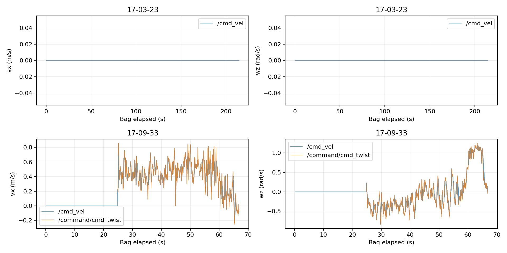

# 2026-11-01 导航零速度排查

2026-11-02 更新：已直接修复纯 Jump 的占位膨胀层配置，并应用到运行中的 Jump 节点，实测恢复速度输出。详见 [修复及实时验证](jump_fix_2026-11-02.md)。下面保留修复前的分析记录。

## 结论

最近两次录制必须区分：**17:09:33 的最新包收到目标后有持续非零速度；17:03:23 的前一个包才是全程零速度。**

17:03 的直接原因是控制器没有发布速度，保活节点因此以 20 Hz 持续发布零速度。结合本次启动日志、实际配置和本机 Nav2 库的离线复现，停在控制器前面的原因是：**仅配置 InflationLayer 的局部地图被恢复流程 reset 后，没有有效更新范围，地图的 current 状态无法恢复，控制器持续等待地图就绪。**

本次只做读取、统计和离线复现，未修改导航配置、插件或运行中的节点。

## Bag 统计

时间均相对各自 bag 第一条消息；“非零”指 vx、vy、wz 任一绝对值大于 1e-6。

| 项目 | 17:03:23 | 17:09:33（最新） |
|---|---:|---:|
| 记录时长 | 214.631 s | 66.917 s |
| /cmd_vel 消息 | 4291 | 1788 |
| /cmd_vel 非零消息 | 0 | 1292 |
| /command/cmd_twist 消息 | 0 | 452 |
| /command/cmd_twist 非零消息 | 0 | 451 |
| /transformed_global_plan 消息 | 0 | 450 |
| /trajectories 消息 | 0 | 449 |
| /plan 消息 | 208 | 41 |

原始数据库：

- `nav_experiment_toolkit/bags/nav_elevation/nav_elevation_2026-11-01_17-03-23/nav_elevation_2026-11-01_17-03-23_0.db3`
- `nav_experiment_toolkit/bags/nav_elevation/nav_elevation_2026-11-01_17-09-33/nav_elevation_2026-11-01_17-09-33_0.db3`

最新包没有 metadata.yaml，本次用 SQLite 只读连接直接读取现有消息，没有重建或修改原包。



### 最新包的零速度对应什么

- 首个 NavigateToPose 目标出现在 +24.734 s；首个非零原始速度在 +24.864 s。
- 最终速度的 496 条零消息中，495 条发生在开始输出非零指令之前。
- 剩余 1 条零指令在 +44.857 s，对应日志中的进度检查失败及恢复。随后继续输出非零速度，没有陷入持续零速度。
- 原始 vx 范围约 -0.254～0.859 m/s，wz 范围约 -0.840～1.253 rad/s。
- 原始指令平均约 10.74 Hz，最大接收间隔约 0.195 s，未达到保活节点的 0.3 s 超时条件。

所以若观察的是最新包开头约 25 秒，看到零速度符合“尚未下发目标”的录制状态。若观察的是整个 17:03 包，则属于下面的控制链路停滞。

## 17:03 持续零速度的证据链

启动日志：`/home/nvidia/.ros/log/component_container_isolated_7652_1793523733952.log`。

1. 日志第 128～129 行：局部地图只加载 `inflation_layer`，与当前 `src/fishbot_navigation2/config/nav2_params_height_jump.yaml` 的局部层配置一致。
2. 第 272～275 行附近：17:03:00 左右开始执行控制，并捕获 HeightJump 起步区。
3. 第 475 行：17:03:20.745 报 `Failed to make progress`。配置要求在 20 秒内移动超过 0.2 m，这条错误发生在开始控制约 20 秒后。
4. 第 477 行：17:03:20.760，恢复流程收到清空整个局部地图的请求。
5. 第 478 行：控制器再次接收跟踪目标。之后持续有重规划和旧跟踪目标中止，但录包期间没有局部参考路径、rollout 可视化或原始速度输出。
6. 本机 `ControllerServer::computeControl()` 二进制中存在等待 `LayeredCostmap::isCurrent()` 的循环，发生在计算和发布速度之前。
7. 本机安装的 `InflationLayer::reset()` 明确执行 `matchSize(); current_ = false;`。用同一本机库构造仅含膨胀层的局部地图后，复现 reset 后连续更新仍不能恢复 current；显式执行非空范围的 cost 更新后立即恢复。
8. `src/keep_zero.py` 订阅 `/command/cmd_twist`，超过 0.3 s 未收到新指令，就每 0.05 s 向 `/cmd_vel` 发布零。包中的 20 Hz 全零输出与这一逻辑吻合。

对应链路：

```text
20 秒进度检查失败
  → 恢复流程清空局部地图
  → 仅有膨胀层，没有有效更新范围
  → 局部地图 current 无法恢复
  → controller 等待地图，不再调用 MPPI 输出速度
  → keep_zero 收不到指令，持续发 0
```

Bag 没有录制 costmap 的内部 current 标志，因此运行时卡在等待循环这一点由日志时序、消息缺失和离线复现共同支持，而不是直接测得该内部变量。初次 20 秒为何未形成足够进展，录包从错误发生约 3.2 秒后才开始，无法用这个包完整还原。

## 离线复现

同目录 `probe.cpp` / `CMakeLists.txt` 是最小机制复现。它不初始化 ROS 通信，不发送运动指令；通过子类设置测试依赖和正常初始状态，调用本机真实 Nav2 更新与 reset 实现。它不是整套导航的回放测试。

```bash
cmake -S docs/analysis/zero_velocity_2026-11-01 -B /tmp/mppi_zero_probe_build
cmake --build /tmp/mppi_zero_probe_build -j2
/tmp/mppi_zero_probe_build/probe
```

实测输出：

```text
before reset: layer=1 map=1
after reset and 20 updates: layer=0 map=0
after explicit nonempty cost update: layer=1 map=1
```

## 最新包的对照与建议

最新启动日志是 `/home/nvidia/.ros/log/component_container_isolated_9345_1793524154847.log`。它加载了 HeightObstacleLayer 和 CostCritic；包内也有高度差地图及带真实障碍的局部地图。

这次在 +44.85 s 同样发生进度检查失败和清空局部地图，但随后恢复非零输出，说明这次没有重现旧配置的持续等待。

- 后续应核对实际启动脚本和参数文件，避免误用局部地图仅含惰性膨胀层的 `nav2_params_height_jump.yaml`；带高程障碍层的入口是 `scripts/start_navigation_height_obstacle.sh`。
- 如果仍需要“只用 HeightJumpCritic、局部地图无障碍源”的模式，应单独修正并验证 reset 后地图就绪的生命周期，包含清图恢复测试。不能把增大进度检查超时当作这个问题的修复。
- 最新包另有性能问题：原始输出约 10.74 Hz，低于配置 20 Hz；对应大量控制周期超时日志。这会影响控制质量，但本包没有因此持续发 0。
- 最新包也出现一次进度检查失败，所以“已经有速度输出”不等于导航任务已完整成功。

两次包的高程消息均持续更新：17:03 的接收时间减消息时间戳最大约 0.223 s，17:09 最大约 0.209 s，接收最大间隔均约 0.147 s。录包期间没有证据支持“高程地图持续超过 1 秒未更新”这一解释。

## 输出文件

- `metrics.json`：话题计数和速度统计。
- `*_raw.csv`、`*_final.csv`：逐消息速度数据；17:03 没有 raw CSV，因为原始话题无消息。
- `velocity_comparison.png`：两次录制的速度对比。
- `probe.cpp`、`CMakeLists.txt`：离线复现代码。
