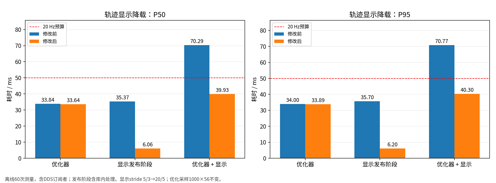
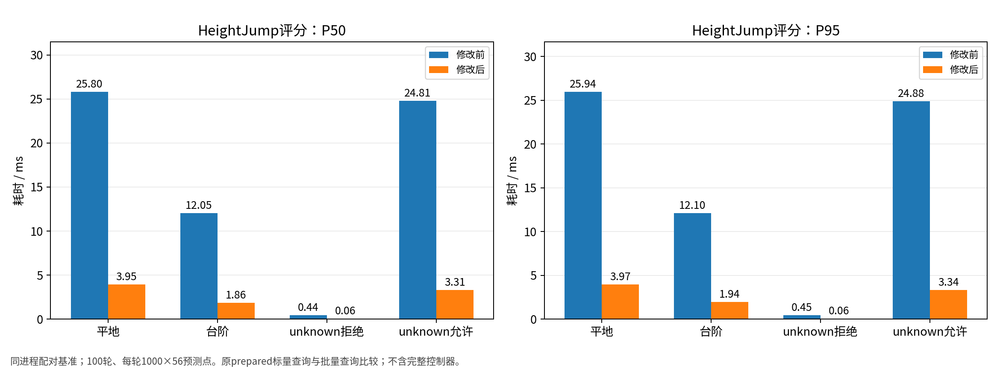
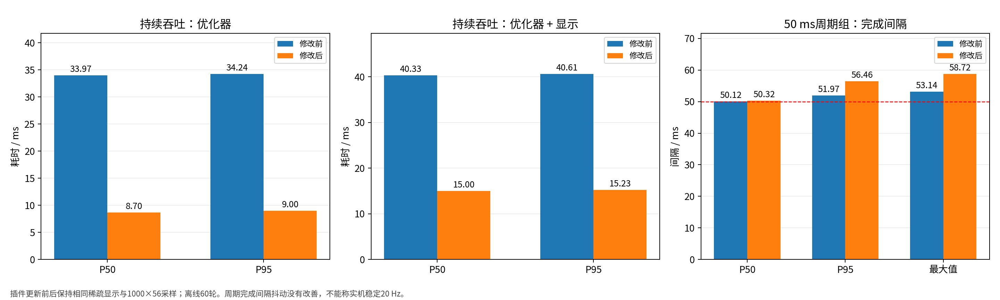
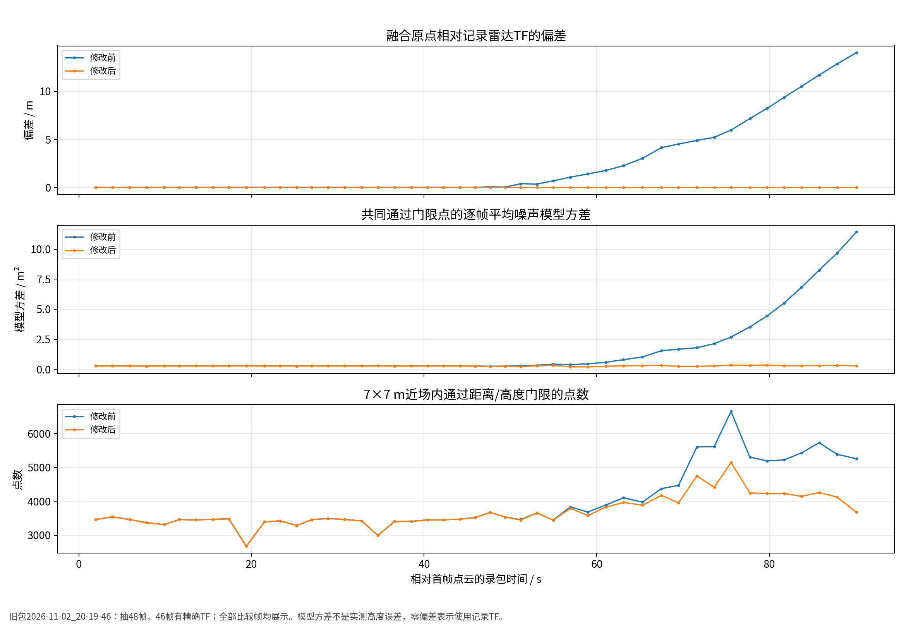
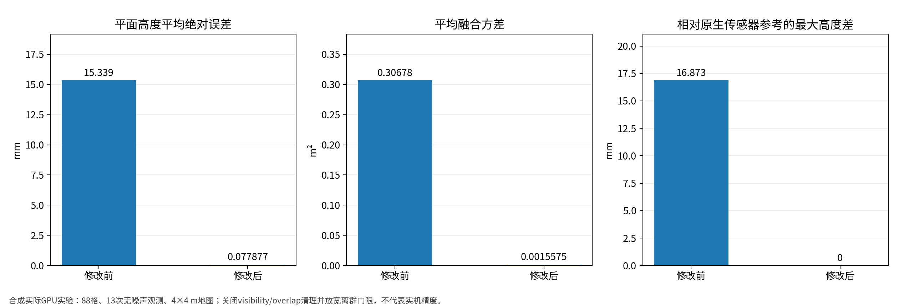
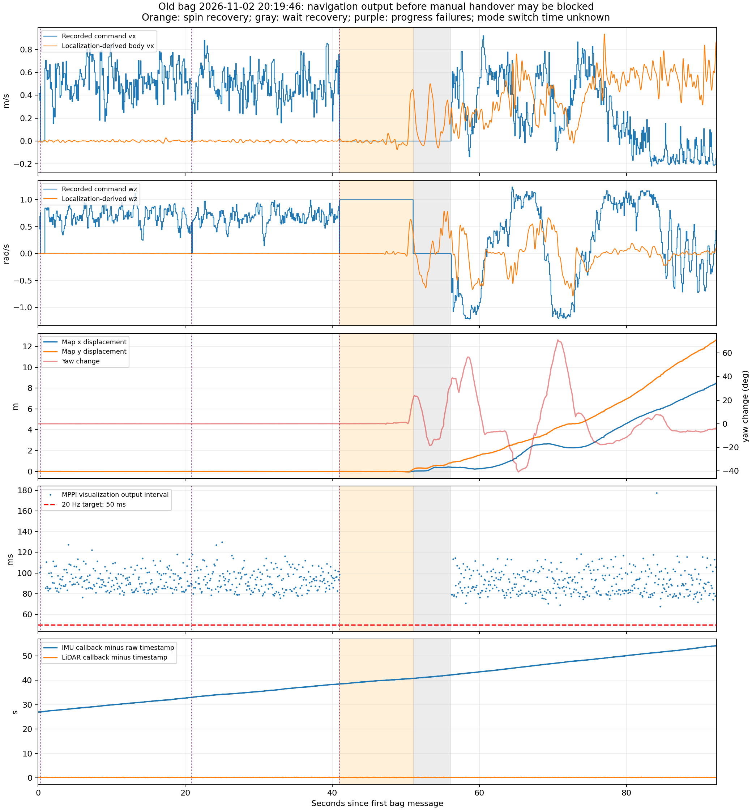
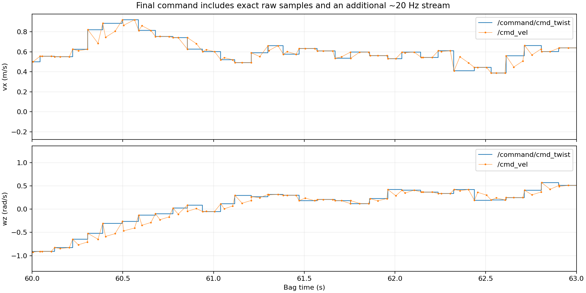
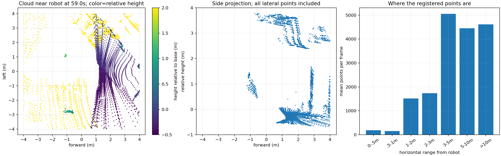
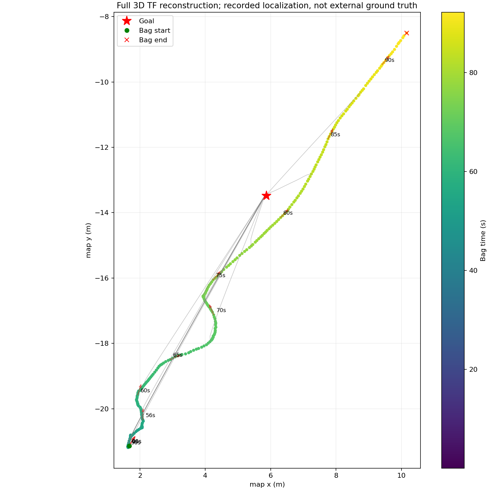

# 两天导航修改：数据图与数值表

数据范围：2026年11月3—4日开展的分析与修改。图6—9直接使用原报告图片。

## 图片目录

| 编号 | 数据图 | 数据来源 |
|---|---|---|
| 1 | [轨迹显示降载：P50/P95耗时](images/01_visualization.png) | 离线性能测量 |
| 2 | [HeightJump四种场景：P50/P95耗时](images/02_heightjump.png) | 离线性能测量 |
| 3 | [完整MPPI耗时与周期完成间隔](images/03_full_mppi.png) | 离线性能测量 |
| 4 | [高程原点、模型方差和过滤点数：逐帧曲线](images/04_sensor_origin.png) | 旧包逐帧离线配对 |
| 5 | [合成GPU平面：高度误差与融合方差](images/05_gpu_plane.png) | 合成GPU实验 |
| 6 | [旧包：指令、反馈、控制间隔与输入时间](images/06_bag_timing.png) | 旧包原始分析图 |
| 7 | [旧包：原始控制指令与最终cmd_vel](images/07_command_streams.png) | 旧包原始分析图 |
| 8 | [旧包：近场点云投影与距离分布](images/08_cloud_density.png) | 旧包原始分析图 |
| 9 | [旧包：定位轨迹与恢复阶段](images/09_trajectory.png) | 旧包原始分析图 |

## 修改前后数值表

| 项目 | 修改前P50 / ms | 修改后P50 / ms | 修改前P95 / ms | 修改后P95 / ms |
|---|---:|---:|---:|---:|
| 轨迹显示降载：优化器+显示 | 70.291 | 39.930 | 70.770 | 40.301 |
| 插件更新：优化器 | 33.975 | 8.696 | 34.236 | 9.005 |
| 插件更新：优化器+显示 | 40.331 | 15.001 | 40.613 | 15.225 |
| 周期组：完成间隔 | 50.117 | 50.324 | 51.971 | 56.462 |

各行为不同实验，不能叠加成整机提速百分比；完成间隔P95未改善。

| HeightJump场景 | 原标量P50 / ms | 批量P50 / ms | 原标量P95 / ms | 批量P95 / ms |
|---|---:|---:|---:|---:|
| 平地 | 25.800 | 3.948 | 25.942 | 3.965 |
| 台阶 | 12.045 | 1.864 | 12.104 | 1.943 |
| unknown拒绝 | 0.445 | 0.059 | 0.452 | 0.060 |
| unknown允许 | 24.812 | 3.310 | 24.880 | 3.344 |

| 高程对照指标 | 修改前 | 修改后 | 数据类型 |
|---|---:|---:|---|
| 融合原点与雷达TF偏差，中位数 | 5.207 m | 0（采用TF） | 旧包中偏差>1m的17帧 |
| 同一批点的平均测量模型方差，中位数 | 2.136454 m² | 0.300119 m² | 同上；不是实测高度误差 |
| 平面高度MAE | 15.339 mm | 0.0779 mm | 合成GPU，88格×13帧 |
| 平均融合方差 | 0.306783 m² | 0.00155745 m² | 同上 |

## 图1：轨迹显示降载：P50/P95耗时

## 图2：HeightJump四种场景：P50/P95耗时

## 图3：完整MPPI耗时与周期完成间隔

## 图4：高程原点、模型方差和过滤点数：逐帧曲线

旧包只计算原点/门限/噪声公式，未重放完整GPU地图时序；原点采用TF不等于零定位误差。

## 图5：合成GPU平面：高度误差与融合方差

这是合成收敛实验，不是现场精度。

## 图6：旧包：指令、反馈、控制间隔与输入时间

这是优化前旧包，不是修改后的效果图；横轴为从录包开始计的秒数。

| 从上到下 | 曲线及单位 | 含义 |
|---|---|---|
| 1：前进速度 | 蓝：指令vx；橙：定位推算机身前向速度，m/s | 定位速度由位置变化平滑求导得到，不是独立底盘测速。 |
| 2：转向角速度 | 蓝：指令wz；橙：定位航向推算角速度，rad/s | 正负代表相反转向，约40.98—50.99s的指令来自旋转恢复。 |
| 3：位移与朝向 | 蓝：map的X位移；橙：map的Y位移，左轴m；淡红：Yaw相对初始变化，右轴deg | 位移相对录包首帧；Yaw不是角速度，也不是俯仰/横滚。 |
| 4：优化输出间隔 | 蓝点：相邻成功优化显示输出间隔，ms；红虚线：50ms | 目标20Hz，活跃实际约10.86Hz；恢复期没有输出不等于MPPI崩溃。 |
| 5：输入时间差 | 蓝：IMU回调日志时间减原始header；橙：LiDAR对应时间差，s | IMU约27—54s且持续扩大；不能直接等同于定位或底盘执行延迟。 |

背景：橙色区间40.978—50.986s为spin恢复，灰色50.999—56.061s为wait阶段；紫色竖虚线为3次无进展失败。录包在旧任务中途开始。

前段手动等待期间机器人静止，不能据此判为定位延迟；手动/导航切换时刻未录制。第三个子图的Yaw图例已补齐。

## 图7：旧包：原始控制指令与最终cmd_vel

## 图8：旧包：近场点云投影与距离分布

## 图9：旧包：定位轨迹与恢复阶段

## 来源与范围

- 显示降载：`docs/analysis/mppi_frequency_2026-11-03/metrics.json`。
- HeightJump及完整MPPI：`docs/analysis/heightjump_implementation_2026-11-03/metrics.json`。
- 高程配对：`docs/analysis/elevation_sensor_origin_2026-11-04/`的JSON和逐帧CSV。
- 旧包：`nav_elevation_2026-11-02_20-19-46`；点云投影来自48帧抽样。
- 暂无修改后的实机包，不能报告实机更新频率、转圈或覆盖率的改善百分比。
