# 2026年11月3—4日导航优化与修改汇报

> 12张16:9高清图，每张可直接作为一页PPT。PNG为2560×1440，SVG可无损放大。

[下载整份PDF](导航优化汇报_12页.pdf) · [查看全部图表预览](全部图表预览.jpg)

**口径：** 离线性能、旧包分析、合成验证分别标注；没有修改后的实机导航对照包。

## 01｜工作总览

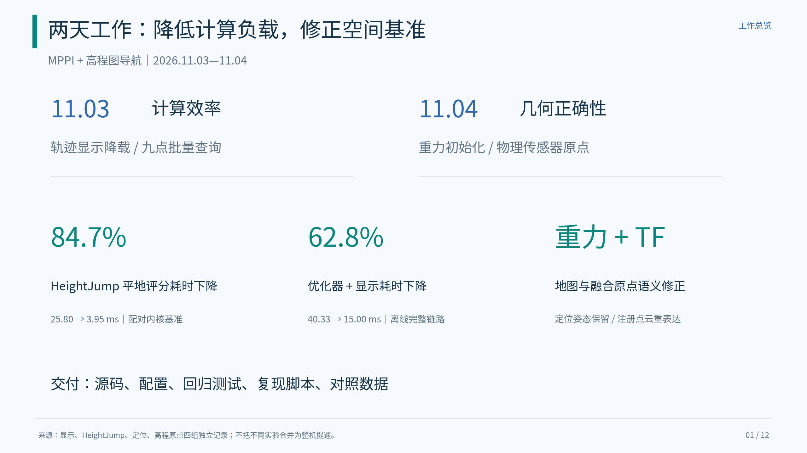

计算效率与空间几何分别改进；现场导航仍需复测。

[PNG](images/01_overview.png) · [SVG](images/01_overview.svg)

## 02｜旧包问题定位

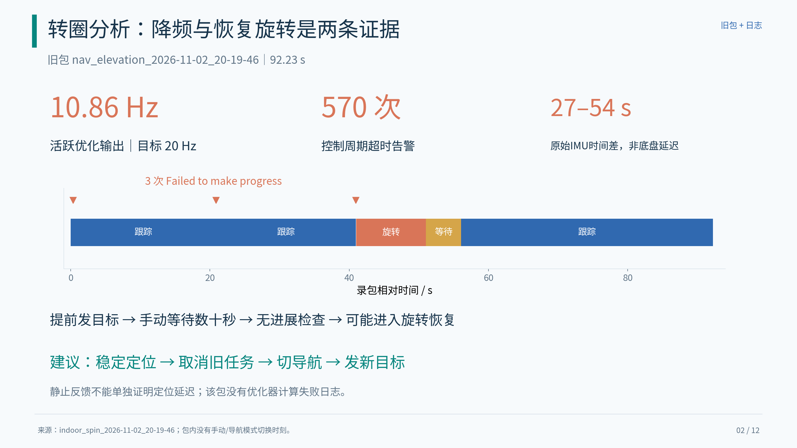

确认存在计算降频和无进展后的旋转恢复；不能唯一归因于底盘延迟。

[PNG](images/02_diagnosis.png) · [SVG](images/02_diagnosis.svg)

## 03｜轨迹显示降载

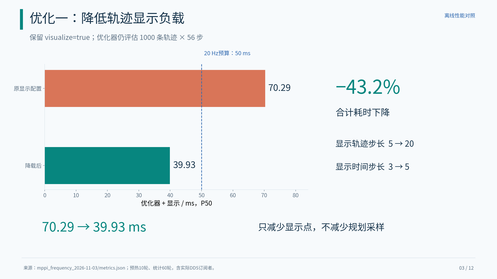

显示 stride 调整使离线优化加显示 P50 从70.29降至39.93 ms。

[PNG](images/03_visualization.png) · [SVG](images/03_visualization.svg)

## 04｜HeightJump 批量查询

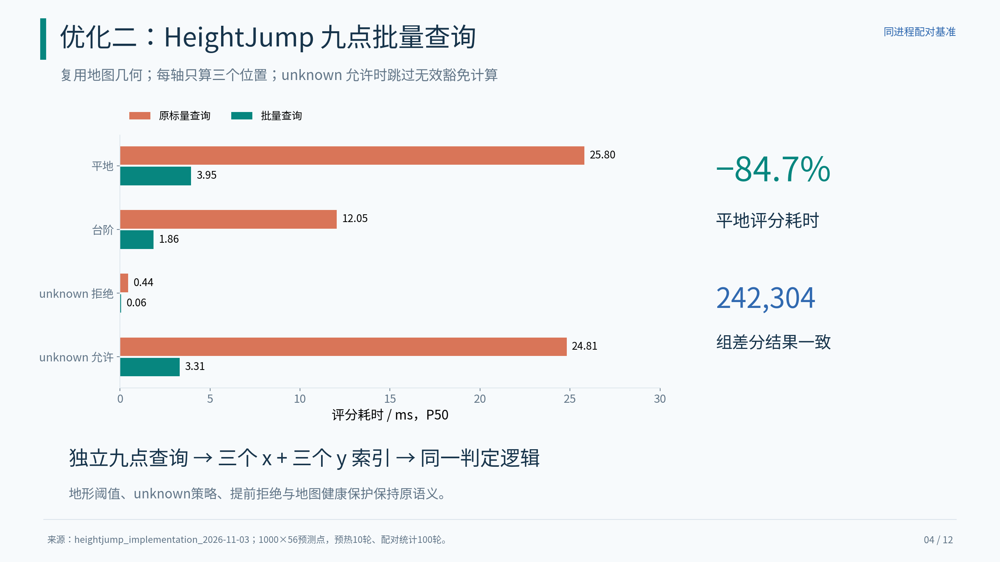

平地评分25.80→3.95 ms；24张地图242304组差分评估一致。

[PNG](images/04_heightjump.png) · [SVG](images/04_heightjump.svg)

## 05｜完整 MPPI 对照

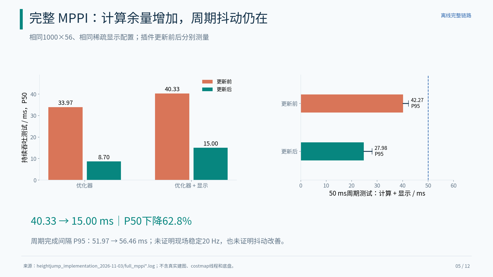

完整优化加显示耗时下降；完成间隔抖动没有同步改善证据。

[PNG](images/05_full_mppi.png) · [SVG](images/05_full_mppi.svg)

## 06｜重力初始化修正

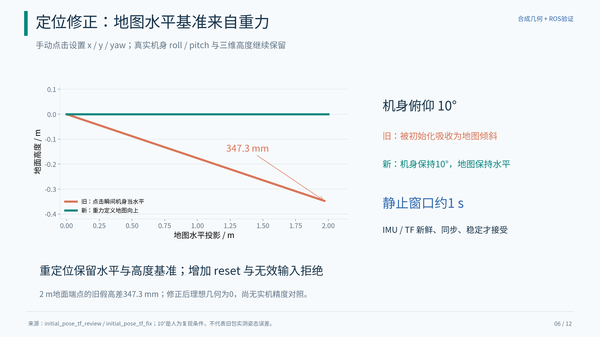

避免将点击瞬间机身姿态固化为地图倾斜；静止与时间校验成为初始化条件。

[PNG](images/06_gravity_alignment.png) · [SVG](images/06_gravity_alignment.svg)

## 07｜物理传感器原点修正

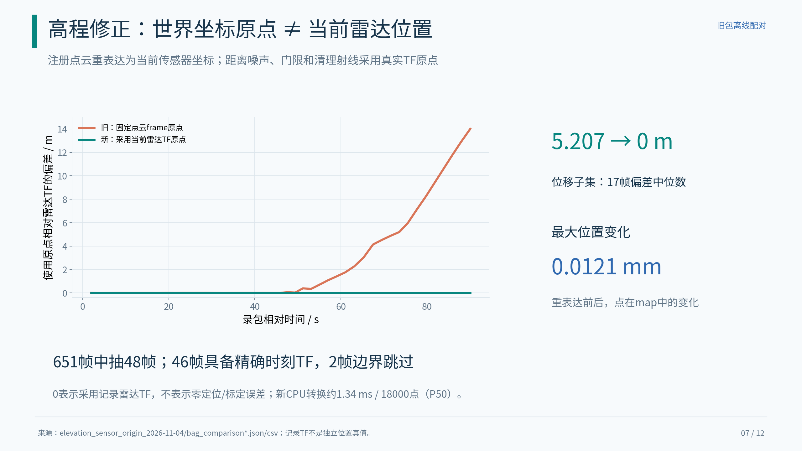

原点跟随雷达运动，同时保持点在map中的几何位置。

[PNG](images/07_sensor_origin.png) · [SVG](images/07_sensor_origin.svg)

## 08｜高程前后对照

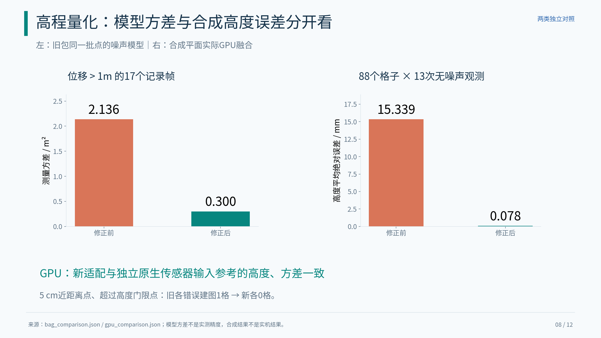

分别展示旧包模型变化和合成GPU收敛结果，避免把方差当高度真值误差。

[PNG](images/08_elevation_results.png) · [SVG](images/08_elevation_results.svg)

## 09｜点云密度与视场

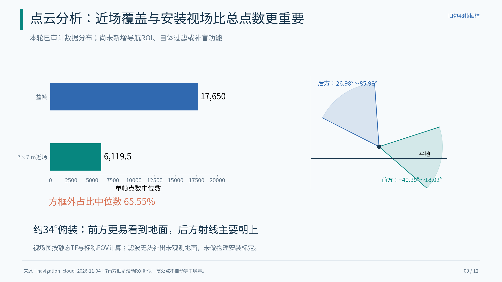

总点量约1.76万，但近场点约6119.5；不能仅减小LIO体素就宣称补盲。

[PNG](images/09_cloud_coverage.png) · [SVG](images/09_cloud_coverage.svg)

## 10｜配置与工具整理

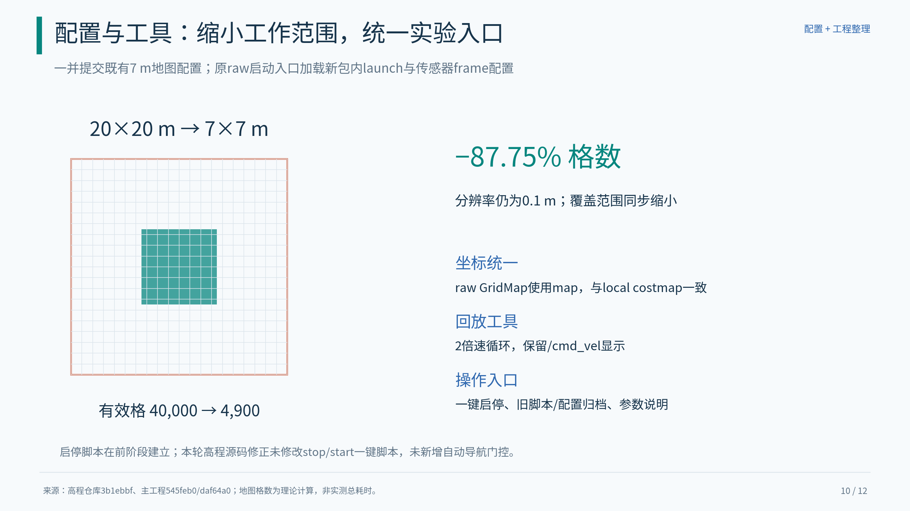

地图大小、frame、回放与入口统一管理；格数变化不能当成整机性能提升。

[PNG](images/10_configuration_tools.png) · [SVG](images/10_configuration_tools.svg)

## 11｜验证覆盖与已知阻断

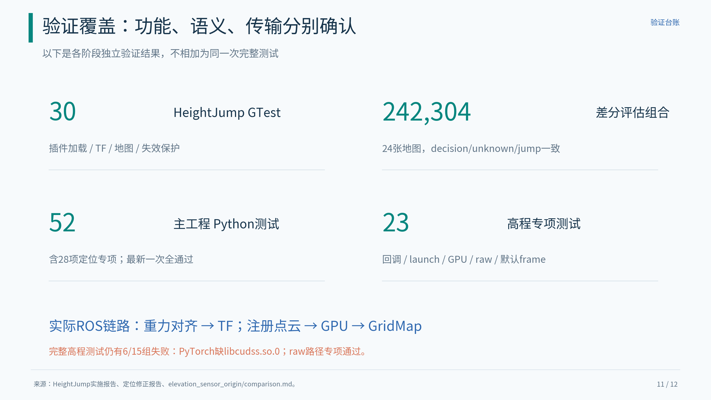

回归与独立ROS链路已有证据；完整高程测试尚未全绿。

[PNG](images/11_validation.png) · [SVG](images/11_validation.svg)

## 12｜交付与实机复测

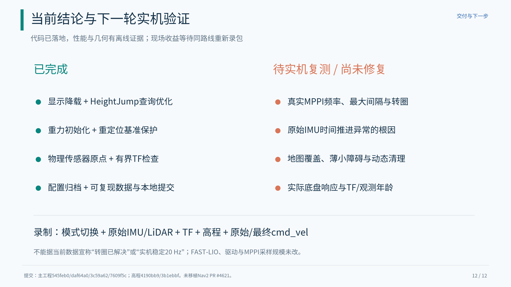

先按正确交接流程重测，再判断真实控制频率、地形覆盖和执行效果。

[PNG](images/12_handover.png) · [SVG](images/12_handover.svg)

## 数据来源

所有数字来自已保存的报告、日志汇总和逐帧数据；副本见[source_data](source_data/)。

| 内容 | 原始记录位置（相对项目根目录） |
|---|---|
| visualization | `docs/analysis/mppi_frequency_2026-11-03/metrics.json` |
| heightjump | `docs/analysis/heightjump_implementation_2026-11-03/metrics.json` |
| old_bag | `docs/analysis/indoor_spin_2026-11-02_20-19-46/metrics.json` |
| gravity | `docs/analysis/initial_pose_tf_review_2026-11-04/metrics.json` |
| cloud | `docs/analysis/navigation_cloud_2026-11-04/metrics.json` |
| origin | `docs/analysis/elevation_sensor_origin_2026-11-04/bag_comparison.json` |
| gpu | `docs/analysis/elevation_sensor_origin_2026-11-04/gpu_comparison.json` |

**版本：** 主工程 `545feb0`、`daf64a0`、`3c59a62`、`7609f5c`；高程仓库 `4190bb9`、`3b1ebbf`。

**未完成：** 实机稳定20Hz、转圈闭环验证、原始IMU时间异常根因、点云补盲/新增导航过滤；未移植Nav2 PR #4621。

**重新生成：** 在项目环境运行 `python3 docs/reports/2026-11-03_04_navigation_optimization/render_report.py`。
